> **자동 변환본 — 직접 고치지 않음.** SDD (소프트웨어 설계 명세서) v0.5 Word 원본을 변환한 사본임.
> 바꿀 내용은 `docs/spec/PENDING.md`에 적고, Word 원본을 고친 뒤 이 스크립트로 다시 만듦. 규칙: `docs/spec/README.md`

**소프트웨어 설계 명세서**

Software Design Document (SDD)

문서 코드: SDD

<table>
<colgroup>
<col />
<col />
</colgroup>
<thead>
<tr class="header">
<th>프로젝트명</th>
<th>부산 외국인 관광 안내 서비스</th>
</tr>
</thead>
<tbody>
<tr class="odd">
<td>팀명</td>
<td>소프트웨어공학 3조</td>
</tr>
<tr class="even">
<td>팀원</td>
<td>김동현: 자연어 코스 추천 
김희찬: 외국인 긴급상황 대응 
장연수: 사진 기반 안내 
손누리: 테스트 및 평가(평가셋 구축, 테스트 케이스)</td>
</tr>
<tr class="odd">
<td>버전</td>
<td>v0.5 (중간고사 제출본)</td>
</tr>
<tr class="even">
<td>작성일</td>
<td>2026-10-15</td>
</tr>
<tr class="odd">
<td>담당교수</td>
<td>임한신</td>
</tr>
</tbody>
</table>

# 문서 관리

| **버전** | **날짜**   | **작성자**             | **변경 내용**                                                                         |
|----------|------------|------------------------|---------------------------------------------------------------------------------------|
| 0.1      | 2026-10-12 | 김동현, 장연수, 김희찬 | 파트별 SDD 초안 작성 (코스 C, 사진 P, 긴급 E)                                         |
| 0.2      | 2026-10-13 | 김희찬                 | 세 파트 통합: 1·2·3·4·12장 작성, 공통 컴포넌트(COMP-C07~C09) 정리. 5~11장은 이후 작성 |
| 0.3      | 2026-10-13 | 김희찬                 | 담당자 이름·표지 정리, 공통 기반을 팀 자체 개발로 기술, 다이어그램 표기 수정          |
| 0.4      | 2026-10-15 | 장연수                 | FR-P021 삭제 반영(COMP-P05, 추적표), 손누리 역할 기재                                 |
| 0.5      | 2026-10-15 | 김희찬                 | 사진 활동 다이어그램에 반경 완화 단계 표기, 전체 문장 개조식 변환                     |
| 1.0      | \[날짜\]   | \[작성자\]             | 최종본 (5~11장 포함)                                                                  |

# 1. 설계 개요 (Design Overview)

## 1.1 목적 및 범위

본 문서는 통합 SRS v1.4(2026-10-15)의 요구사항을 어떤 구조로 구현할지 설계함. 범위는 세 핵심 기능인 자연어 코스 추천(코스, 접두어 C), 사진 기반 안내(사진, P), 외국인 긴급상황 대응(긴급, E)과 세 기능이 함께 쓰는 공통 기반(장소 지식베이스 수집기, AIService, 지도 위젯)임. 설계의 공통 원칙은 "판단은 코드가, 읽기와 요약은 AI가"임. 코스 순서, 간판 매칭 점수, 위급 판정과 장소 선택은 결정론적 규칙으로 구현해 단위 테스트로 검증하고, LLM은 조건 추출·상황 분류·근거 요약·설명 생성에만 씀. 이번 판(v0.5)은 1·2·3·4·12장을 작성했고 5~11장은 이후 작성함.

**추적성 원칙: 주요 설계 요소에는 관련 SRS 요구사항 ID(FR/NFR/AI-REQ)를 명시함. 공통 컴포넌트는 코스 파트 ID(COMP-C07~C09)를 세 파트가 그대로 참조함.**

## 1.2 관련 문서

- SRS (부산 외국인 관광 안내 서비스, 통합본) v1.4 — 2026-10-15

- 파트별 SDD 초안 v0.1 — 코스(김동현), 사진(장연수), 긴급(김희찬), 2026-10-12

- 외부 API 활용가이드: TourAPI KorService2, 국립중앙의료원 약국·응급의료기관 정보 조회 서비스, V-World 지오코더

- 긴급 안내 RAG 지식베이스 초안 v0.1 (rag_kb_draft.md)

## 1.3 설계 목표 및 품질 속성

| 품질 속성                             | 목표                                                   | 설계 대응                                                                                                         | 관련 NFR                          |
|---------------------------------------|--------------------------------------------------------|-------------------------------------------------------------------------------------------------------------------|-----------------------------------|
| Correctness (실행 가능성·오확정 방지) | 제약 위반 코스 0건, 사진 확정 정밀도 95%               | 코스 순서는 결정적 코드(CoursePlanner)가 정하고, 사진은 확정 임계값 + 1·2위 마진 규칙으로 판정                    | NFR-C006, AI-REQ-P01              |
| Safety (위급 누락 방지)               | 위급 문장 재현율 100%                                  | 최종 긴급도 = 키워드 OR LLM, 연락 버튼을 모든 긴급 화면에 상시 표시                                               | FR-E004·E007, AI-REQ-E02          |
| Performance                           | 코스·사진 핵심 결과 5초, 설명 10초, 긴급 연락 버튼 1초 | 결과 API와 설명 API 분리, 긴급은 LLM 없는 quick → guide 2단계, 후보 축소(코스 15곳, 사진 반경 500 m)              | NFR-C001, NFR-P001, NFR-E001·E002 |
| Availability                          | LLM·OCR·공공 API 장애에도 화면 표시                    | 대체 경로(규칙 파서, 템플릿 설명, 재촬영·이름 검색, 키워드·유형 버튼), 정적 정보 배치 저장과 실시간 정보 5분 캐시 | NFR-C002, NFR-P004, NFR-E003      |
| Privacy                               | 사진·좌표·긴급 입력 문장 저장 0건                      | 메모리 처리, EXIF 미사용, 긴급 요청 무상태, 로그 마스킹과 30일 삭제                                               | NFR-C003, NFR-P002·P003, NFR-E004 |
| Maintainability                       | LLM·OCR 엔진 교체는 설정 1줄, 규칙은 데이터로 관리     | AIService·OcrEngine 인터페이스(Strategy), 결정표·키워드·가중치·임계값을 설정 파일·데이터로 분리                   | NFR-C005, NFR-P005, NFR-E009      |
| Testability                           | 규칙 모듈 단위 테스트 커버리지 80%                     | 코스 탐색기, 정규화·점수화, 운영 중 판정·결정표를 DB·네트워크 없는 순수 함수로 구현                               | NFR-C006, NFR-P006, NFR-E009      |

# 2. 시스템 아키텍처 (System Architecture)

## 2.1 전체 아키텍처

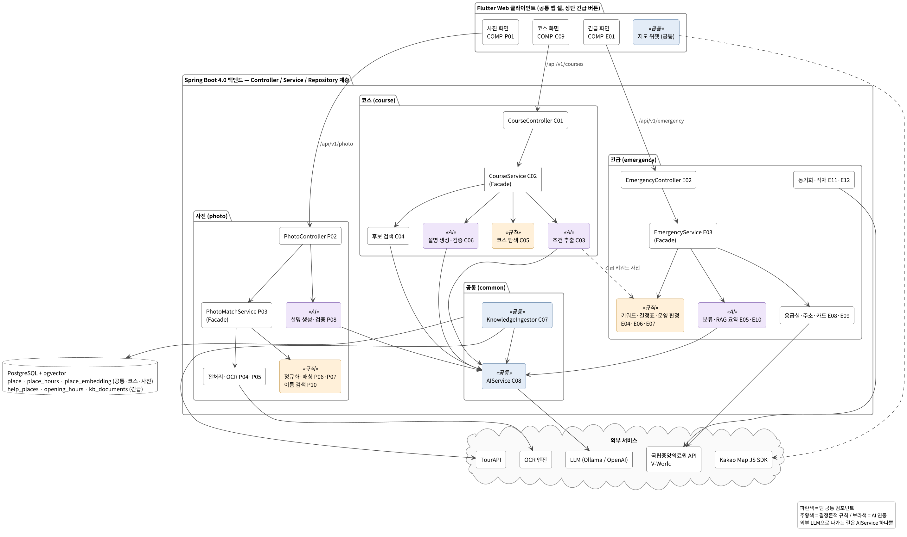

그림 2-1. 전체 아키텍처 (UML Component Diagram)

클라이언트는 하나의 Flutter Web 앱이고, 세 기능 화면이 공통 앱 셸과 지도 위젯을 공유함. 긴급 화면으로 가는 버튼은 어느 화면에서든 상단에 있음. 백엔드는 하나의 Spring Boot 애플리케이션이며 기능별 패키지(course, photo, emergency)와 공통 패키지(common)로 나눔. 각 기능의 Service가 Facade로서 내부 단계를 순서대로 호출하고, 외부 LLM으로 나가는 길은 AIService(COMP-C08) 하나뿐임. 사진은 OCR 엔진까지만 전달되고 LLM에는 전달되지 않음. 데이터는 PostgreSQL + pgvector 하나에 두며, 공통 place 테이블은 코스·사진이, help_places와 kb_documents는 긴급이 씀.

## 2.2 아키텍처 스타일 및 선택 이유

| **결정 ID** | **선택**                                                                          | **이유**                                                                                  | **대안/Trade-off**                                                                                                    | **관련 요구사항**            |
|-------------|-----------------------------------------------------------------------------------|-------------------------------------------------------------------------------------------|-----------------------------------------------------------------------------------------------------------------------|------------------------------|
| ADR-C01     | Layered + Client-Server                                                           | Controller-Service-Repository 계층으로 책임을 나누고, 팀이 익숙한 Spring 구조로 직접 구현 | 계층 수만큼 파일 증가                                                                                                 | NFR-C005                     |
| ADR-C02     | 일반 벡터 RAG (그래프 RAG·재랭커·에이전트 없음)                                   | 장소 수천 건 규모에서 충분하고 3학년 범위에 맞음                                          | 복합 질의에 약함 → 조건 필터로 보완                                                                                   | AI-REQ-C01                   |
| ADR-C03     | 순서 결정은 코드(DFS + 가지치기), LLM은 조건 추출·설명만                          | 제약 보장·재현성·테스트 가능                                                              | LLM만 쓸 때보다 코드량 증가                                                                                           | FR-C006, NFR-C006            |
| ADR-C04     | PostgreSQL + pgvector 단일 DB                                                     | 장소·벡터를 한 쿼리로 필터 + 검색, 인프라 1개                                             | 전용 벡터 DB 대비 기능 적음(이 규모엔 문제 없음)                                                                      | FR-C004, FR-C005             |
| ADR-C05     | 다국어 임베딩 bge-m3, 한국어 데이터만 저장                                        | 번역 저장 없이 영·일 질의 검색                                                            | 모델 교체 시 전체 재임베딩                                                                                            | AI-REQ-C05                   |
| ADR-C06     | 코스와 설명 API 분리                                                              | 체감 응답시간 단축, LLM 장애 격리                                                         | 클라이언트 호출 2회                                                                                                   | NFR-C001, NFR-C002           |
| ADR-C07     | 운영시간은 수집 때 1회만 LLM으로 구조화                                           | 요청마다 해석하면 느리고 비용·결과가 흔들림                                               | 원문 변경 시 재처리 필요                                                                                              | FR-C018                      |
| ADR-P01     | OCR → 정규화 → 위치 후보 → 점수 매칭 파이프라인 (사진을 VLM에 통째로 보내지 않음) | 결과를 숫자로 평가·재현할 수 있고 "단순 LLM 호출 제외" 조건에 답할 수 있음                | 코드량 증가, OCR 오류에 취약(자모 유사도로 보완)                                                                      | AI-REQ-P01, NFR-P006         |
| ADR-P02     | 매칭 대상은 팀 공통 place(TourAPI contentId) 단일 DB                              | 코스 연동·근거 카드가 일관되고 추가 수집 호출이 0회                                       | TourAPI 미등록 가게는 식별 불가(NOT_FOUND로 정직하게 응답)                                                            | FR-P015, AI-REQ-P01          |
| ADR-P03     | 위치 반경 필터를 점수화 전에 적용                                                 | 후보를 좁혀 정확도·속도를 높임                                                            | 위치 거부 시 효과 감소(구 전체 후보로 대체)                                                                           | FR-P003, FR-P006, AI-REQ-P05 |
| ADR-P04     | 사진·좌표 비저장, 메모리 처리, 매칭 요청은 무상태                                 | 개인정보 최소화                                                                           | 재현·디버깅은 마스킹된 로그(텍스트·점수)로만 가능                                                                     | NFR-P002, NFR-P003           |
| ADR-P05     | OcrEngine 인터페이스, 엔진은 PoC 후 결정(로컬 우선)                               | 호출 한도·사진 외부 전송 위험을 낮추고 교체가 쉬움                                        | 로컬 엔진은 컨테이너·자원 필요                                                                                        | NFR-P005, NFR-P007           |
| ADR-P06     | 식별 API와 설명 API 분리                                                          | 체감 시간 단축, LLM 장애 격리 (ADR-C06과 같은 패턴)                                       | 클라이언트 호출 2회                                                                                                   | NFR-P001, NFR-P004           |
| ADR-P07     | 설명 단계는 벡터 검색 대신 contentId 정확 조회로 근거 확보                        | 확정 장소의 문서가 이미 정해져 검색이 불필요                                              | 팀 RAG 뼈대와 형태가 다름                                                                                             | AI-REQ-P02                   |
| ADR-P08     | 확정·후보·실패 3분기 (임계값 + 마진)                                              | 오확정을 막고 사용자 선택으로 보완                                                        | 후보 화면이 늘어 UX 단계 증가                                                                                         | AI-REQ-P01                   |
| ADR-E01     | 팀 공통 백엔드에 기능 패키지로 추가                                               | 지도·다국어·AIService 공통 사용, 팀 숙련도                                                | 별도 서비스로 분리 — 독립 배포 가능하나 시연 환경이 복잡해짐                                                          | NFR-E009                     |
| ADR-E02     | 정적 정보는 하루 1회 배치 저장, 응급실 병상·메시지만 요청 시 조회 + 5분 캐시      | 오퍼레이션별 하루 1,000건 한도, 응답속도, 장애 대비                                       | 매 요청 API 호출 — 단순하지만 한도·지연·장애에 취약 / 캐시로 최대 5분 지연                                            | NFR-E002·E003·E007           |
| ADR-E03     | LLM은 분류·슬롯 추출만, 한국어 카드 문장은 템플릿                                 | 약사·경찰에게 보여줄 문장의 오류 방지, 테스트 가능                                        | LLM 자유 생성 — 자연스럽지만 검증 불가                                                                                | AI-REQ-E07                   |
| ADR-E04     | 최종 긴급도 = LLM OR 키워드                                                       | 위급을 놓치는 비용이 과잉 경고보다 큼                                                     | AND 결합 — 오경보는 줄지만 놓칠 위험 / 과잉 경고 증가 감수                                                            | FR-E007                      |
| ADR-E05     | 2단계 응답 (quick → guide)                                                        | LLM 대기 없이 연락 버튼 즉시 표시                                                         | 단일 API — 구현 단순, LLM 대기 중 버튼 없음                                                                           | NFR-E001                     |
| ADR-E06     | 공공데이터 우선, 좌표 변환은 V-World (카카오 로컬 미사용)                         | 카카오 로컬 응답 저장·LLM 전송 금지 조건 회피                                             | 카카오 로컬 — 커버리지 넓지만 이용조건 위반                                                                           | SRS 2.4 제약                 |
| ADR-E07     | 도움처를 단일 테이블(help_places + type)로 통합, 공통 place와 분리                | 반경 검색·정렬·운영 판정 로직을 하나로, TourAPI에 없는 장소                               | 종류별 테이블 — 쿼리·코드 중복 / 공통 place에 합치기 — contentId 체계와 맞지 않고 사진 매칭 후보에 약국·편의점이 섞임 | FR-E011                      |
| ADR-E08     | RAG 검색은 pgvector 정확 검색 (문서 수십 건)                                      | 별도 벡터 DB 불필요, 팀 공통 스택                                                         | 전용 벡터 DB — 규모 대비 과함                                                                                         | AI-REQ-E03                   |
| ADR-E09     | 관리자 기능은 로그인 대신 로컬 관리자 프로필(@Profile)에서만 등록                 | 팀 공통 방침(로그인 없음), 인증 구현 비용 제거, 시연 빌드에 관리자 경로가 없음            | JWT + ADMIN 역할 — 로그인 기능 전체가 필요 / 원격 관리 불가 감수                                                      | NFR-E005, FR-E021·E022       |

# 3. 컴포넌트 설계 (Component Design)

컴포넌트는 31개임: 공통 3개(COMP-C07~C09), 코스 6개(COMP-C01~C06), 사진 10개(COMP-P01~P10), 긴급 12개(COMP-E01~E12). 공통 컴포넌트는 코스 파트가 정의하고 사진·긴급 파트가 함께 씀.

### 3.1 공통 컴포넌트

| **ID**   | **컴포넌트**                           | **책임**                                                                                                          | **입력**               | **출력**                             | **의존성**                                    | **관련 요구사항**                           |
|----------|----------------------------------------|-------------------------------------------------------------------------------------------------------------------|------------------------|--------------------------------------|-----------------------------------------------|---------------------------------------------|
| COMP-C07 | KnowledgeIngestor + HoursParser (공통) | TourAPI 장소 수집·재개, 운영시간 구조화, 임베딩, 수집 후 정규화 상호(name_norm) 생성 연동                         | 지역·유형 설정         | place·place_hours·place_embedding 행 | TourApiClient, AIService, NameNormalizer(P06) | FR-C017, FR-C018, FR-P020                   |
| COMP-C08 | AIService (공통)                       | LLM 호출(complete)·임베딩(embed) 추상화, 제공자 교체(Ollama/OpenAI), 호출별 타임아웃·재시도, 호출 로그(본문 제외) | Prompt, 스키마, 옵션   | 구조화 응답, 벡터                    | Spring AI (Ollama / OpenAI)                   | NFR-C002, C005, C007, NFR-E003, AI-REQ-E05  |
| COMP-C09 | Frontend 코스 화면 + 지도 위젯 (공통)  | 코스 입력·가정 칩·시간표·근거 카드, 공통 지도 위젯(번호 핀·말풍선·범위 맞춤, Kakao Map JS SDK로 직접 구현)        | 사용자 입력, 마커 목록 | HTTP 요청 / 화면, 지도               | Backend API, 카카오맵 SDK                     | FR-C001, C008, C009, C011, FR-P013, FR-E013 |

### 3.2 자연어 코스 추천 (COMP-C)

| **ID**   | **컴포넌트**                       | **책임**                                                                                  | **입력**      | **출력**                   | **의존성**                         | **관련 요구사항**                 |
|----------|------------------------------------|-------------------------------------------------------------------------------------------|---------------|----------------------------|------------------------------------|-----------------------------------|
| COMP-C01 | CourseController                   | HTTP 입출력, 입력 검증(500자)                                                             | HTTP 요청     | JSON                       | CourseService                      | FR-C001                           |
| COMP-C02 | CourseService                      | 단계 순서 조율(Facade), 코스 버전 저장, 긴급 판정 시 저장 생략                            | CourseRequest | Course                     | C03~C06, Repository                | FR-C006, C014, NFR-C001, NFR-C003 |
| COMP-C03 | IntentParser                       | 조건·수정 명령 추출, 범위 판별, 긴급 감지(위급 키워드 사전 COMP-E04 공유), 규칙 대체 파서 | 요청 문장     | CourseIntent / EditOp 목록 | AIService, KeywordRuleEngine       | FR-C002, C003, C012, C013, C015   |
| COMP-C04 | CandidateRetriever                 | SQL 필터 + 벡터 검색                                                                      | CourseIntent  | 후보 15곳(유사도 포함)     | PlaceRepository, AIService(임베딩) | FR-C004, C005                     |
| COMP-C05 | CoursePlanner                      | 제약 검사, 탐색, 점수, 조건 완화                                                          | 후보 + 제약   | 시간표 포함 코스           | 없음(순수 함수)                    | FR-C006, C007, NFR-C006           |
| COMP-C06 | NarrationService + OutputValidator | 설명 생성·검증·템플릿 대체                                                                | Course, lang  | Narration                  | AIService                          | FR-C010, AI-REQ-C01               |

### 3.3 사진 기반 안내 (COMP-P)

| **ID**   | **컴포넌트**                            | **책임**                                                                                       | **입력**                      | **출력**                          | **의존성**                                                   | **관련 요구사항**                                   |
|----------|-----------------------------------------|------------------------------------------------------------------------------------------------|-------------------------------|-----------------------------------|--------------------------------------------------------------|-----------------------------------------------------|
| COMP-P01 | PhotoScreen (Frontend)                  | 사진 선택·촬영, 위치 권한 요청, 결과·후보·실패 화면, 지도                                      | 사용자 입력(사진, 위치)       | HTTP 요청 / 화면                  | Backend API, COMP-C09                                        | FR-P001~P003, P009, P010, P013~P015, P018, NFR-P009 |
| COMP-P02 | PhotoController                         | HTTP 입출구, 입력 검증(형식·크기·언어 코드), API-P01~P03 라우팅                                | multipart/JSON 요청           | JSON                              | PhotoMatchService, PlaceNarrationService, PlaceSearchService | FR-P002, P016                                       |
| COMP-P03 | PhotoMatchService                       | 단계 순서 조율(Facade): 전처리 → OCR → 정규화 → 후보 → 점수 → 분기, 반경 완화, 타임아웃·재시도 | 사진 바이트, 위치(선택), lang | MatchResult                       | COMP-P04~P07, P09                                            | FR-P003~P008, P017, NFR-P001, P004                  |
| COMP-P04 | ImagePreprocessor                       | 형식 판별, 리사이즈, EXIF 미사용·폐기, 메모리 처리                                             | 사진 바이트                   | 축소된 메모리 이미지              | 없음                                                         | FR-P002, NFR-P002, AI-REQ-P04                       |
| COMP-P05 | OcrEngine                               | 이미지에서 텍스트 블록(텍스트·신뢰도·위치) 추출, 엔진 교체                                     | 이미지                        | OcrResult                         | PaddleOcrClient 또는 CloudOcrClient                          | FR-P004, NFR-P004, P005, P007                       |
| COMP-P06 | NameNormalizer                          | 정규화 규칙, 자모 분해, name_norm 생성                                                         | 문자열                        | 정규화 문자열                     | 설정(DATA-P05)                                               | FR-P005, P020, NFR-P006                             |
| COMP-P07 | PlaceMatcher                            | 후보 조회(반경·구·유형), 점수화, 정렬, 확정·후보·실패 판정                                     | 블록 목록, 위치, 설정         | MatchResult(candidates, decision) | PlaceRepository, COMP-P06                                    | FR-P003, P006~P008, P017, NFR-P006, AI-REQ-P01, P05 |
| COMP-P08 | PlaceNarrationService + OutputValidator | 확정 장소 원문으로 설명 생성·검증·템플릿 대체                                                  | contentId, lang               | Narration                         | AIService(COMP-C08), PlaceRepository                         | FR-P011, P012, NFR-P004, AI-REQ-P02                 |
| COMP-P09 | MatchLogger                             | 평가용 로그(마스킹 텍스트·점수·분기), 30일 후 삭제                                             | MatchResult                   | 로그 행                           | DB                                                           | FR-P019, NFR-P003, P008                             |
| COMP-P10 | PlaceSearchService                      | 이름 직접 검색(정규화 + 점수, 거리 제외)                                                       | 상호 문자열, lang             | 후보 3곳                          | COMP-P06, PlaceRepository                                    | FR-P016                                             |

### 3.4 외국인 긴급상황 대응 (COMP-E)

| **ID**   | **컴포넌트**                                 | **책임**                                                                                    | **입력**              | **출력**               | **의존성**                           | **관련 요구사항**                   |
|----------|----------------------------------------------|---------------------------------------------------------------------------------------------|-----------------------|------------------------|--------------------------------------|-------------------------------------|
| COMP-E01 | Flutter 긴급 화면                            | 상황 입력, 결과(연락 버튼·지도·목록·카드·할 일), 카드 전체 화면, 유형 선택, 비긴급 안내     | 사용자 입력, 위치     | HTTP 요청 / 화면       | COMP-E02, COMP-C09                   | FR-E001~E004, E013~E015, E018       |
| COMP-E02 | EmergencyController                          | 공개 API 엔드포인트, 입력 검증(500자), 응답 직렬화                                          | HTTP 요청             | JSON                   | COMP-E03                             | FR-E001, E003, NFR-E005             |
| COMP-E03 | EmergencyService                             | 전체 흐름 조율(Facade), 최종 긴급도 결합, 대상 지역 판정, 대체 체인                         | GuideRequest          | GuideResult            | COMP-E04~E10                         | FR-E007, E017, E018, NFR-E003       |
| COMP-E04 | KeywordRuleEngine                            | 위급 키워드 사전 매칭(한·영·일, 정규화 후). 코스 IntentParser와 공유                        | 입력 문장             | urgent 여부, 매칭 범주 | emergency_keywords                   | FR-E005, FR-C013                    |
| COMP-E05 | SituationClassifier                          | LLM 호출(5초·재시도 0), JSON 스키마 검증, 신뢰도 판정                                       | 입력 문장(마스킹)     | Triage                 | COMP-C08                             | FR-E006, E008, AI-REQ-E01, E05, E06 |
| COMP-E06 | DecisionTable                                | 유형별 장소 종류·대체 순서 결정(설정 데이터)                                                | Triage, 현재 시각     | RoutePlan              | 결정표 설정                          | FR-E009                             |
| COMP-E07 | HelpPlaceFinder / OpenNowEvaluator           | 운영 중 판정(24시 초과·공휴일·미확인), 반경 1km→3km 검색, 거리순 3곳                        | RoutePlan, 좌표, 시각 | HelpPlace 목록         | help_places, opening_hours, COMP-E08 | FR-E010, E011                       |
| COMP-E08 | ErRealtimeClient                             | 응급실 가용병상·메시지 조회, 5분 캐시, 진료불가 판정                                        | 기관 ID               | ErStatus               | 국립중앙의료원 API, er_status_cache  | FR-E012, E020, NFR-E007             |
| COMP-E09 | KoreanCardBuilder / ReverseGeocoder          | 좌표→주소 변환, 템플릿에 슬롯·주소 삽입, 사용자 언어 병기                                   | Triage, 좌표, locale  | KoreanCard             | V-World API, card_templates          | FR-E015, AI-REQ-E07                 |
| COMP-E10 | GuidanceRetriever (RAG)                      | 지식베이스 검색(Top-3), 근거 요약, 근거 ID·금지 표현 검증                                   | 유형, locale          | 할 일 문장, 출처       | kb_documents, COMP-C08               | FR-E016, AI-REQ-E03, E04            |
| COMP-E11 | DataSyncScheduler                            | 매일 04:00 약국·응급실 동기화, 정규화, 동기화 로그                                          | 스케줄                | DB 갱신                | 국립중앙의료원 API                   | FR-E019, NFR-E008                   |
| COMP-E12 | EmergencyAdminController (local 프로필 전용) | CSV 검증·적재·좌표계 변환, 지식베이스·키워드·템플릿 파일 재적재(임베딩 재생성), 수동 동기화 | CSV, seed 파일        | DB 갱신                | @Profile("local-admin"), COMP-C08    | FR-E021, E022                       |

# 4. UML 설계

## 4.1 Class Diagram

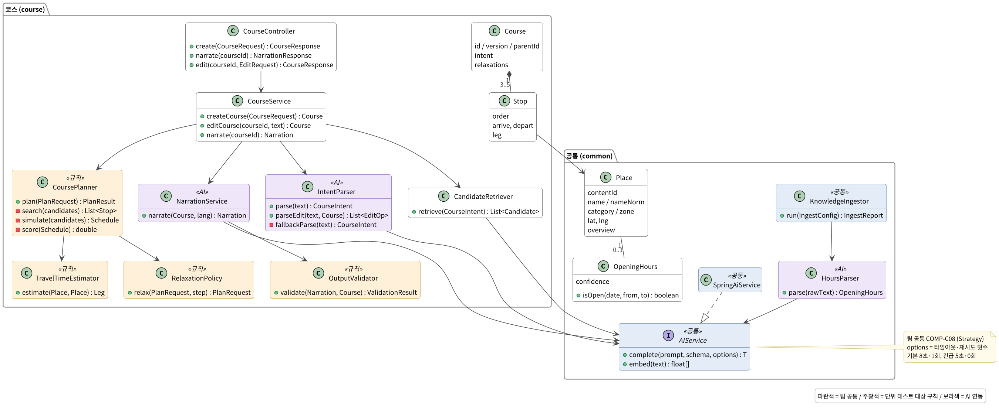

그림 4-1. 클래스 다이어그램 ① 공통 + 자연어 코스 추천

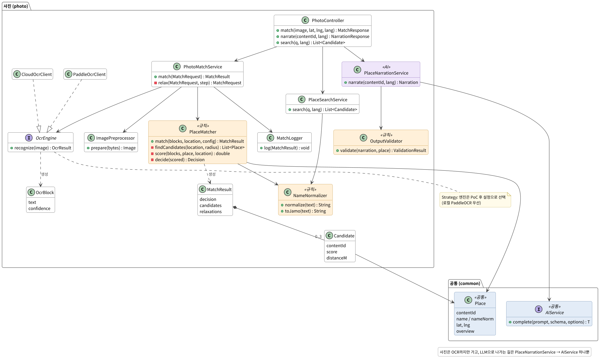

그림 4-2. 클래스 다이어그램 ② 사진 기반 안내

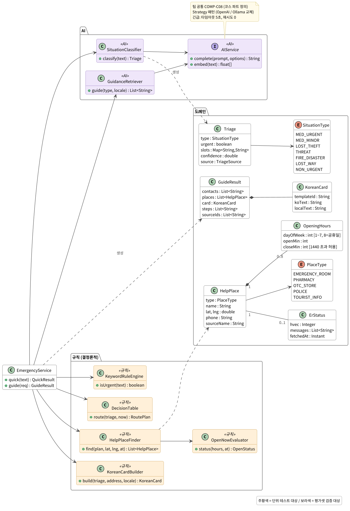

그림 4-3. 클래스 다이어그램 ③ 외국인 긴급상황 대응

*관련 요구사항: FR-C002~C010, C015, C017, C018, FR-P001~P020, FR-E005~E016, NFR-C005·C006, NFR-P005·P006, NFR-E009, AI-REQ-E01·E03·E07*

*관련 Use Case: UC-C01, UC-C02, UC-C05, UC-P01~P03, UC-E01~E05*

## 4.2 Sequence Diagram

**SD-C01 코스 생성과 설명**

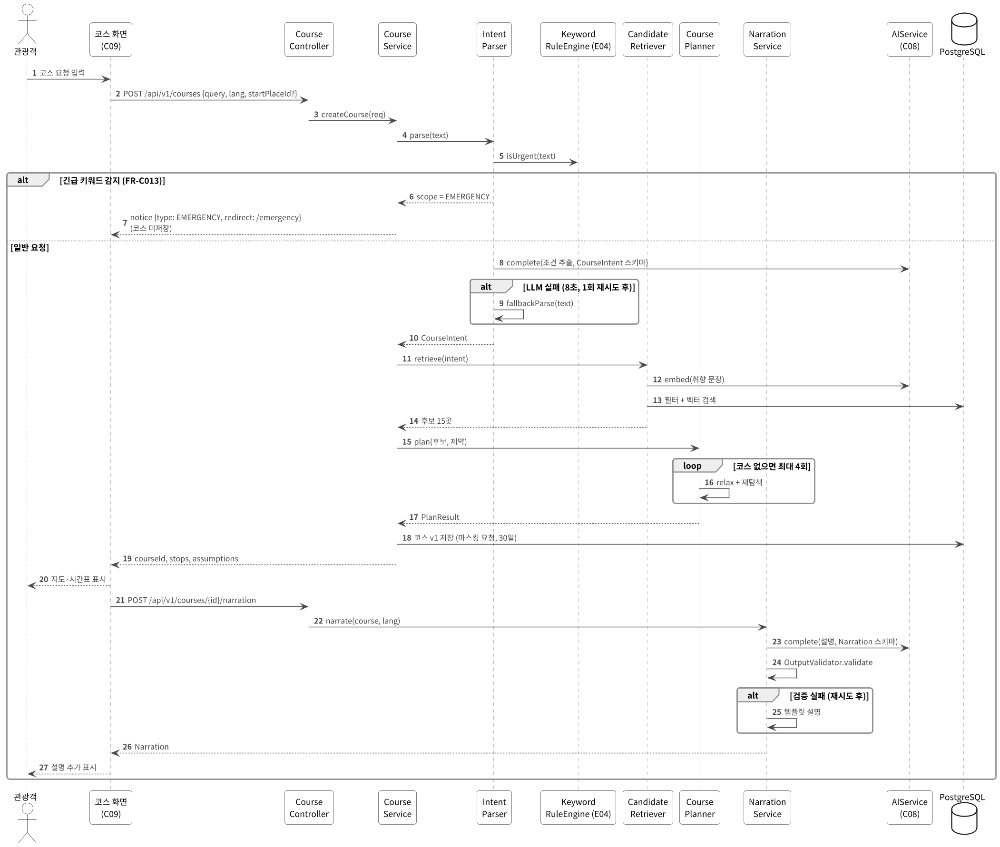

관련 Use Case: UC-C01 관련 요구사항: FR-C002~C010, FR-C013, AI-REQ-C01, AI-REQ-C02

**SD-C02 대화형 수정**

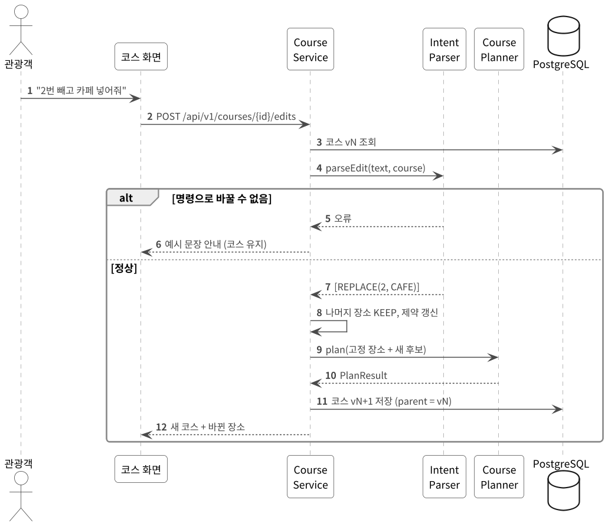

관련 Use Case: UC-C02 관련 요구사항: FR-C015, FR-C006, FR-C007

**SD-P01 간판 사진 → 확정 → 설명**

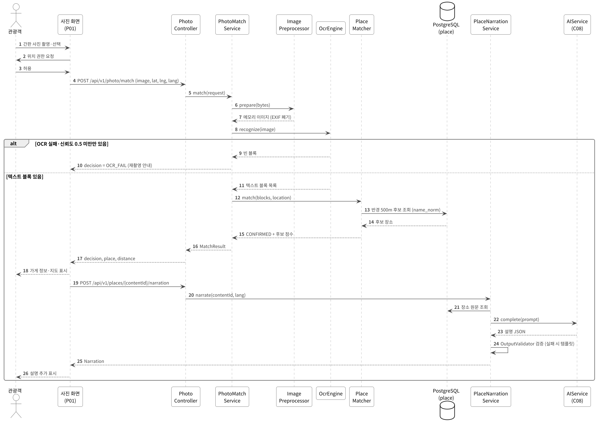

관련 Use Case: UC-P01 관련 요구사항: FR-P001~P013, AI-REQ-P01, AI-REQ-P02

**SD-P02 후보 선택·이름 직접 검색 → 코스 시작**

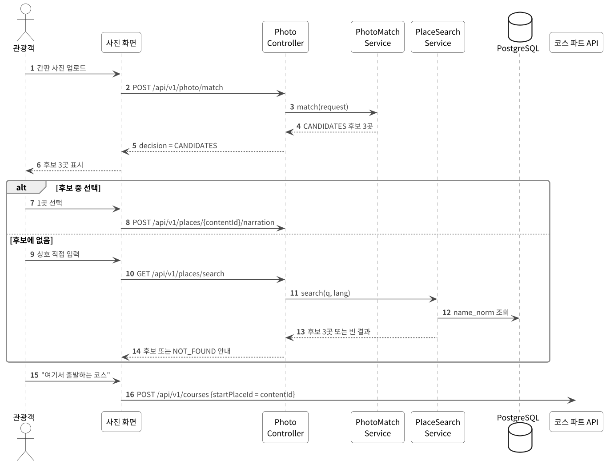

관련 Use Case: UC-P02, UC-P03 관련 요구사항: FR-P009, FR-P014~P016

**SD-E01 긴급 상황 안내 (2단계 응답)**

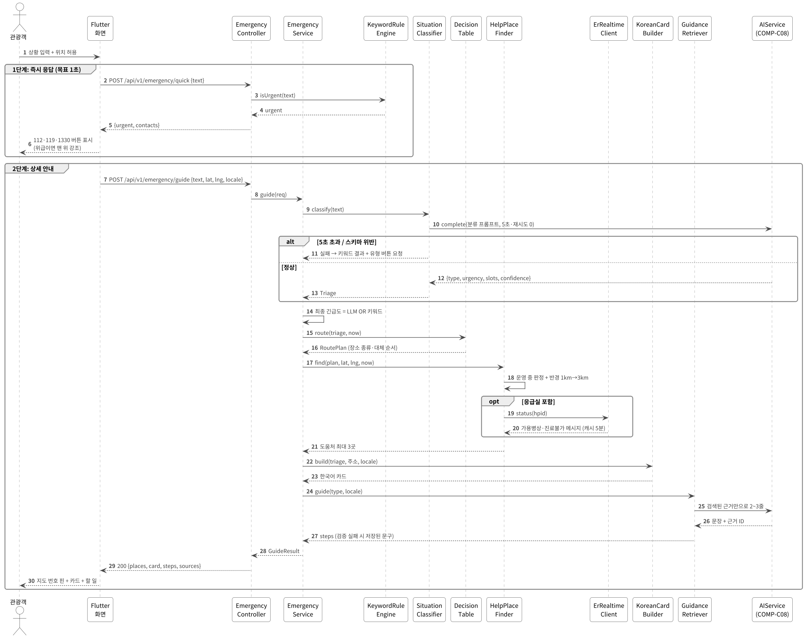

관련 Use Case: UC-E01~E05 관련 요구사항: FR-E003, FR-E006~E016, AI-REQ-E01·E03·E05, NFR-E001

**SD-E02 도움처 데이터 동기화**

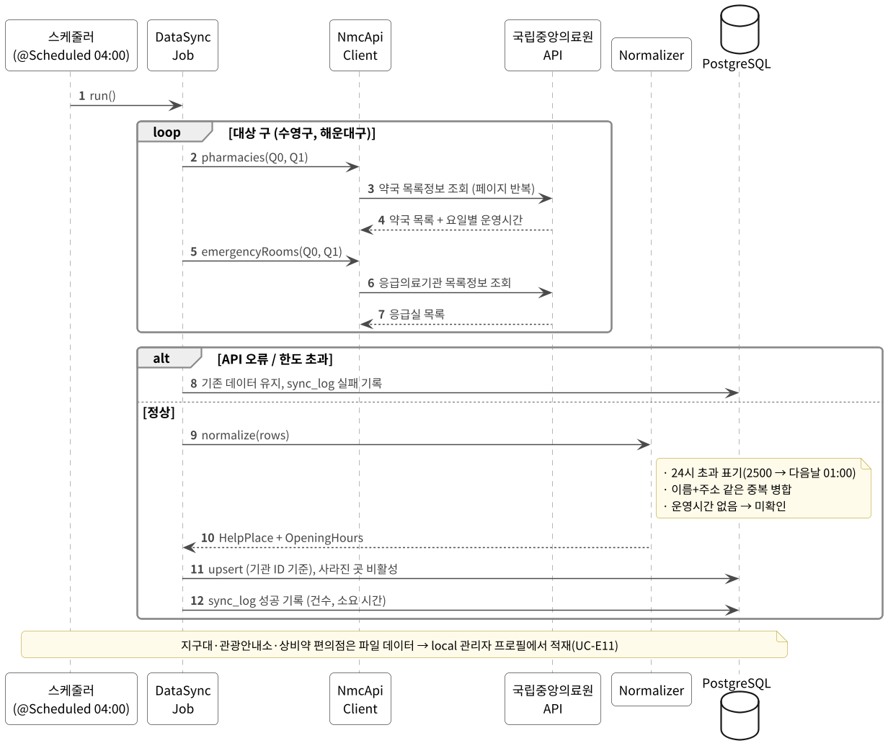

관련 Use Case: UC-E10 관련 요구사항: FR-E010, FR-E019, NFR-E007·E008

**SD-X01 기능 간 연동 (사진 → 코스, 코스 → 긴급, 긴급 → 코스)**

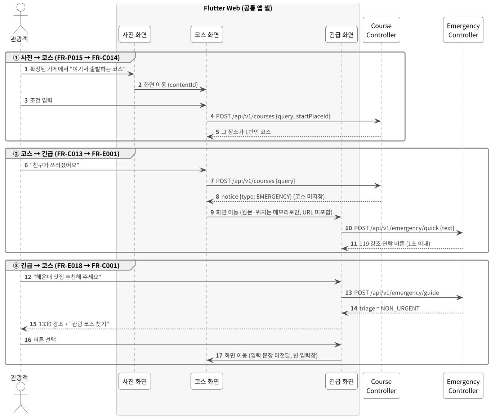

관련 Use Case: UC-P03, UC-C04, UC-C01, UC-E01, UC-E08 관련 요구사항: FR-P015, FR-C013, FR-C014, FR-E001, FR-E018

## 4.3 기타 UML (선택)

필요에 따라 상태·활동 다이어그램을 추가했음.

**상태 다이어그램: 지식베이스 수집기 (장소 하나가 거치는 상태)**

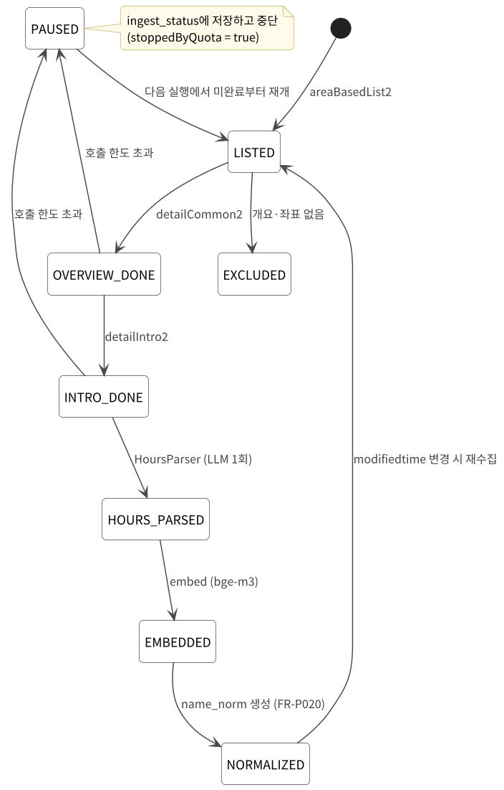

관련 Use Case: UC-C05 관련 요구사항: FR-C017, FR-C018, FR-P020

**활동 다이어그램: 간판 매칭 흐름과 분기**

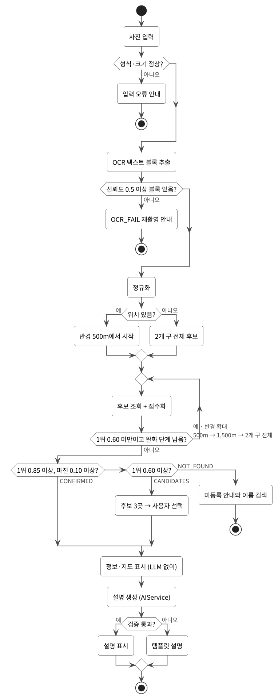

관련 Use Case: UC-P01 관련 요구사항: FR-P002~P014. 지도·정보는 LLM 없이도 나온다(NFR-P004).

**활동 다이어그램: 긴급 상황 분류와 결정표 분기 (레인 = 관광객 / 코드 / AI)**

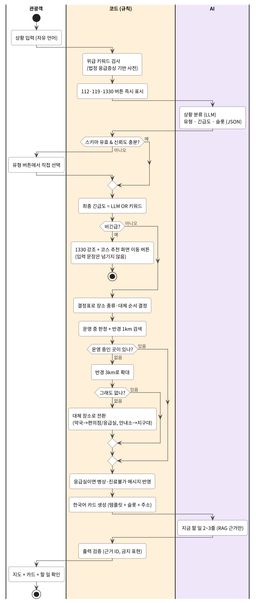

관련 Use Case: UC-E01, UC-E06, UC-E08 관련 요구사항: FR-E007~E011, FR-E018

# 5. 데이터베이스 및 데이터 설계

## 5.1 ER Diagram / Data Model

\[ER Diagram 삽입 위치\]

*관련 요구사항: \[FR-\_\_\_, NFR-\_\_\_\]*

## 5.2 테이블/컬렉션 정의

| **테이블/컬렉션** | **필드**  | **타입** | **PK/FK** | **Null** | **설명**    | **관련 요구사항** |
|-------------------|-----------|----------|-----------|----------|-------------|-------------------|
| places            | id        | UUID/INT | PK        | N        | 장소 식별자 | FR-001            |
| places            | name      | VARCHAR  | \-        | N        | 장소명      | FR-001            |
| \[table\]         | \[field\] | \[type\] | \[key\]   | \[Y/N\]  | \[설명\]    | \[FR-\_\_\_\]     |

# 6. API 설계

| **API ID** | **Method** | **Endpoint**     | **목적**    | **Request** | **Response**     | **관련 요구사항** |
|------------|------------|------------------|-------------|-------------|------------------|-------------------|
| API-001    | POST       | /api/query       | 텍스트 질의 | {query}     | {answer,sources} | FR-001            |
| API-002    | POST       | /api/image-query | 이미지 질의 | multipart   | {answer,places}  | FR-002            |

# 7. AI / LLM / VLM 설계

## 7.1 AI 파이프라인

작성 지침: 입력 전처리 → 검색/RAG → Prompt → LLM/VLM → 후처리/검증 → 응답 흐름을 기술함.

\[AI Pipeline Diagram 삽입 위치\]

*관련 요구사항: \[AI-REQ-\_\_\_, FR-\_\_\_, NFR-\_\_\_\]*

## 7.2 모델 및 인터페이스

| **AI 요소** | **모델/서비스** | **역할**         | **입력/출력**          | **교체 가능성/추상화** | **관련 요구사항** |
|-------------|-----------------|------------------|------------------------|------------------------|-------------------|
| LLM         | \[모델명\]      | 자연어 응답/추천 | Text+Context → Text    | AIService              | AI-REQ-01, FR-001 |
| VLM         | \[모델명\]      | 이미지 이해      | Image+Text → Text/JSON | AIService              | AI-REQ-01, FR-002 |

## 7.3 Prompt 설계

- System Prompt 목적: \[ \]

- 검색 대상 데이터/Chunk 전략: \[ \]

- Top-k 또는 Retrieval 기준: \[ \]

- 출처 표시 방식: \[ \]

- Hallucination 완화 방법: \[ \]

*관련 요구사항: \[AI-REQ-\_\_\_, FR-\_\_\_, NFR-\_\_\_\]*

## 7.4 AI 실패/예외 처리

| **상황**    | **처리 전략**            | **사용자 메시지/로그** | **관련 요구사항** |
|-------------|--------------------------|------------------------|-------------------|
| API Timeout | 재시도/대체 응답         | \[안내 메시지\]        | AI-REQ-02         |
| 근거 부족   | 답변 제한/출처 부족 표시 | \[안내 메시지\]        | AI-REQ-01         |
| 부적절 입력 | 검증 후 차단/정제        | \[안내 메시지\]        | AI-REQ-03         |

# 8. 예외 처리 및 로깅

| **오류 ID** | **오류 상황** | **시스템 동작** | **로그/모니터링**  | **관련 요구사항**      |
|-------------|---------------|-----------------|--------------------|------------------------|
| ERR-001     | 잘못된 입력   | 400 응답/안내   | 입력 오류 로그     | FR-\_\_\_ / NFR-\_\_\_ |
| ERR-002     | 외부 AI 장애  | Fallback/503    | 오류/응답시간 로그 | AI-REQ-02 / NFR-\_\_\_ |

# 9. 보안 및 개인정보 설계

- 인증/권한: \[ \]

- API Key/Secret 관리: \[환경변수, Secret Store 등\]

- 개인정보 저장 최소화: \[ \]

- 입력/출력 검증: \[ \]

- 로그에 민감정보를 남기지 않음: \[ \]

## 관련 요구사항 매핑

| **보안/개인정보 설계 요소** | **관련 요구사항**          |
|-----------------------------|----------------------------|
| 인증/권한                   | \[NFR-\_\_\_\]             |
| API Key/Secret 관리         | \[NFR-\_\_\_\]             |
| 개인정보 저장 최소화        | \[NFR-\_\_\_ / AI-REQ-03\] |
| 입력/출력 검증              | \[NFR-\_\_\_ / AI-REQ-03\] |
| 민감정보 로그 방지          | \[NFR-\_\_\_ / AI-REQ-03\] |

# 10. 배포 및 운영 설계

## 10.1 Deployment Diagram

\[Deployment Diagram 삽입 위치\]

*관련 요구사항: \[NFR-\_\_\_, 보안/운영 요구사항\]*

## 10.2 CI/CD

- Repository/Branch 전략: \[ \]

- Pull Request/Review 규칙: \[ \]

- 자동 Build/Test: \[GitHub Actions 등\]

- 배포 환경: \[ \]

*관련 요구사항: \[NFR-\_\_\_ / 프로젝트 운영 요구사항\]*

# 11. 디자인 패턴 및 주요 설계 원칙

| **패턴/원칙**    | **적용 위치** | **적용 이유**       | **관련 클래스/컴포넌트** | **관련 요구사항**          |
|------------------|---------------|---------------------|--------------------------|----------------------------|
| Adapter/Strategy | AIService     | AI 제공자 교체 용이 | AIProvider               | NFR-005                    |
| \[패턴\]         | \[위치\]      | \[이유\]            | \[요소\]                 | \[NFR-\_\_\_ / FR-\_\_\_\] |

# 12. 요구사항-설계 추적표

요구사항이 Use Case, 컴포넌트, 클래스·테이블, API, 시퀀스, 테스트로 어떻게 반영되는지 추적함. API ID(API-C01~C06, API-P01~P03, API-E01~E07)는 파트별 SDD 초안의 정의를 따르며 6장에 정리할 예정임.

| **요구사항 ID**   | **Use Case**                       | **아키텍처/컴포넌트**        | **Class/DB**                                         | **API**              | **Sequence**    | **Test Case**     | **상태/비고**         |
|-------------------|------------------------------------|------------------------------|------------------------------------------------------|----------------------|-----------------|-------------------|-----------------------|
| FR-C001           | UC-C01                             | COMP-C01, C09                | CourseController                                     | API-C01              | SD-C01          | TC-C01            | Draft                 |
| FR-C002, C003     | UC-C01                             | COMP-C03, C08                | IntentParser / course_plan.intent                    | API-C01              | SD-C01          | TC-C02, AI-TC-C04 | Draft                 |
| FR-C004, C005     | UC-C01                             | COMP-C04                     | CandidateRetriever / place, place_embedding          | API-C01              | SD-C01          | TC-C03            | Draft                 |
| FR-C006, C007     | UC-C01, C02                        | COMP-C05                     | CoursePlanner, RelaxationPolicy / place_hours        | API-C01              | SD-C01          | TC-C04~C08        | Draft                 |
| FR-C010           | UC-C01                             | COMP-C06, C08                | NarrationService, OutputValidator / course_narration | API-C02              | SD-C01          | AI-TC-C01         | Draft                 |
| FR-C011           | UC-C03                             | COMP-C09                     | place                                                | API-C05              | \-              | TC-C10            | Draft                 |
| FR-C012, C013     | UC-C01                             | COMP-C03, E04                | IntentParser(scope), KeywordRuleEngine               | API-C01              | SD-C01, SD-X01  | TC-C11            | 긴급 연동             |
| FR-C014           | UC-C04                             | COMP-C02                     | CourseService                                        | API-C01              | SD-P02, SD-X01  | TC-C12            | 사진 연동             |
| FR-C015           | UC-C02                             | COMP-C03, C05                | IntentParser.parseEdit / course_plan.parent_id       | API-C03              | SD-C02          | TC-C13            | Should                |
| FR-C017, C018     | UC-C05                             | COMP-C07                     | KnowledgeIngestor, HoursParser / place.ingest_status | API-C06              | 상태 다이어그램 | TC-C14, AI-TC-C06 | Draft                 |
| NFR-C001          | \-                                 | COMP-C02 (설명 분리)         | \-                                                   | API-C01, C02         | SD-C01          | TC-C20            | Draft                 |
| NFR-C002          | \-                                 | COMP-C08                     | AIService                                            | \-                   | SD-C01 (alt)    | TC-C21            | Draft                 |
| NFR-C003          | \-                                 | COMP-C02                     | course_plan.query_text (마스킹, 30일)                | API-C01              | SD-C01          | TC-C22            | 긴급 판정 요청 미저장 |
| AI-REQ-C01        | UC-C01                             | COMP-C06                     | OutputValidator                                      | API-C02              | SD-C01          | AI-TC-C01         | Draft                 |
| FR-P001, P002     | UC-P01                             | COMP-P01, P02, P04           | PhotoController, ImagePreprocessor                   | API-P01              | SD-P01          | TC-P001           | Draft                 |
| FR-P003           | UC-P01                             | COMP-P01, P07                | PlaceMatcher                                         | API-P01              | SD-P01          | TC-P002           | Draft                 |
| FR-P004           | UC-P01                             | COMP-P05                     | OcrEngine, OcrBlock                                  | API-P01              | SD-P01          | AI-TC-P01         | Draft                 |
| FR-P005           | UC-P01                             | COMP-P06                     | NameNormalizer / place.name_norm                     | API-P01              | SD-P01          | TC-P003           | Draft                 |
| FR-P006, P007     | UC-P01                             | COMP-P07                     | PlaceMatcher / place                                 | API-P01              | SD-P01          | TC-P004, P005     | Draft                 |
| FR-P008, P017     | UC-P01                             | COMP-P03, P07                | PhotoMatchService, MatchResult                       | API-P01              | SD-P01          | TC-P006, P013     | Draft                 |
| FR-P009           | UC-P02                             | COMP-P01                     | Candidate                                            | API-P01              | SD-P02          | TC-P007           | Draft                 |
| FR-P010, P013     | UC-P01                             | COMP-P01, C09                | Place                                                | API-P01              | SD-P01          | TC-P008, P009     | Draft                 |
| FR-P011, P012     | UC-P01                             | COMP-P08, C08                | PlaceNarrationService, OutputValidator               | API-P02              | SD-P01          | AI-TC-P02         | Draft                 |
| FR-P014           | UC-P01, P02                        | COMP-P01                     | \-                                                   | API-P01              | SD-P01          | TC-P010           | Draft                 |
| FR-P015           | UC-P03                             | COMP-P01                     | \-                                                   | API-C01              | SD-P02, SD-X01  | TC-P011           | 코스 연동             |
| FR-P016           | UC-P02                             | COMP-P10                     | PlaceSearchService                                   | API-P03              | SD-P02          | TC-P012           | Draft                 |
| FR-P018           | UC-P01                             | COMP-P01                     | \-                                                   | \-                   | \-              | TC-P014           | Could                 |
| FR-P019           | UC-P01                             | COMP-P09                     | MatchLogger / photo_match_log                        | \-                   | SD-P01          | TC-P015           | Draft                 |
| FR-P020           | UC-C05                             | COMP-P06, C07                | NameNormalizer / place.name_norm                     | API-C06              | 상태 다이어그램 | TC-P016           | Draft                 |
| NFR-P001          | \-                                 | COMP-P03                     | \-                                                   | API-P01, P02         | SD-P01          | TC-P018           | Draft                 |
| NFR-P002, P003    | \-                                 | COMP-P04, P09                | ImagePreprocessor, MatchLogger                       | \-                   | SD-P01          | TC-P019, P020     | Draft                 |
| NFR-P004          | \-                                 | COMP-P03, P05, P08           | \-                                                   | \-                   | SD-P01          | TC-P021           | Draft                 |
| AI-REQ-P01, P05   | UC-P01                             | COMP-P05~P07                 | PlaceMatcher                                         | API-P01              | SD-P01          | AI-TC-P01, P03    | Draft                 |
| AI-REQ-P02        | UC-P01                             | COMP-P08                     | OutputValidator                                      | API-P02              | SD-P01          | AI-TC-P02         | Draft                 |
| FR-E001, E002     | UC-E01, E02, E07                   | COMP-E01                     | \-                                                   | API-E02              | SD-E01, SD-X01  | TC-E001           | Draft                 |
| FR-E003, E005     | UC-E01                             | COMP-E02, E04                | KeywordRuleEngine / emergency_keywords               | API-E01              | SD-E01          | TC-E002           | Draft                 |
| FR-E006, E008     | UC-E01, E06                        | COMP-E05, C08                | SituationClassifier, Triage                          | API-E02              | SD-E01          | AI-TC-E01         | Draft                 |
| FR-E007           | UC-E01                             | COMP-E03                     | EmergencyService                                     | API-E02              | SD-E01          | TC-E003           | Draft                 |
| FR-E009, E011     | UC-E03                             | COMP-E06, E07                | DecisionTable, HelpPlaceFinder / help_places         | API-E02              | SD-E01          | TC-E004           | Draft                 |
| FR-E010           | UC-E03                             | COMP-E07                     | OpenNowEvaluator / opening_hours                     | \-                   | SD-E02          | TC-E005           | Draft                 |
| FR-E012, E020     | UC-E03                             | COMP-E08                     | ErStatus / er_status_cache                           | API-E02              | SD-E01          | TC-E006           | Draft                 |
| FR-E013, E014     | UC-E01, E09                        | COMP-E01, C09                | HelpPlace                                            | API-E02              | SD-E01          | TC-E007           | Draft                 |
| FR-E015           | UC-E04                             | COMP-E09                     | KoreanCardBuilder / card_templates                   | API-E02              | SD-E01          | TC-E008           | Draft                 |
| FR-E016           | UC-E05                             | COMP-E10                     | GuidanceRetriever / kb_documents                     | API-E02              | SD-E01          | AI-TC-E02         | Draft                 |
| FR-E017           | UC-E01                             | COMP-E03                     | EmergencyService                                     | API-E02              | SD-E01          | TC-E009           | Draft                 |
| FR-E018           | UC-E08                             | COMP-E01, E03                | \-                                                   | API-E02              | SD-X01          | TC-E010           | 코스 연동             |
| FR-E019           | UC-E10                             | COMP-E11                     | DataSyncJob / sync_logs                              | API-E06, E07         | SD-E02          | TC-E011           | Draft                 |
| FR-E021, E022     | UC-E11                             | COMP-E12                     | help_places, kb_documents                            | API-E04, E05         | \-              | TC-E012           | Draft                 |
| NFR-E001          | \-                                 | ADR-E05                      | \-                                                   | API-E01              | SD-E01          | TC-E013           | Draft                 |
| NFR-E003          | \-                                 | ADR-E02, COMP-E03            | \-                                                   | API-E02              | SD-E01          | TC-E014           | Draft                 |
| NFR-E004, E005    | \-                                 | ADR-E09, COMP-E03            | request_logs                                         | \-                   | \-              | TC-E015           | Draft                 |
| NFR-E007          | UC-E10                             | ADR-E02, COMP-E08, E11       | er_status_cache                                      | \-                   | SD-E02          | TC-E016           | Draft                 |
| AI-REQ-E01~E07    | UC-E01                             | COMP-E05, E09, E10           | Triage, KoreanCard                                   | API-E02              | SD-E01          | AI-TC-E01~E03     | Draft                 |
| AC-X01~X03 (통합) | UC-P03→C04, UC-C01→E01, UC-E08→C01 | COMP-P01, C02, C03, E01, E04 | \-                                                   | API-C01, API-E01·E02 | SD-X01          | TC-X01~X03        | Draft                 |

*※ 초기 설계 단계에서는 미정 요소를 비워둘 수 있으며, 구현·테스트가 진행되면서 API/Class/Test Case 매핑을 보완함.*
