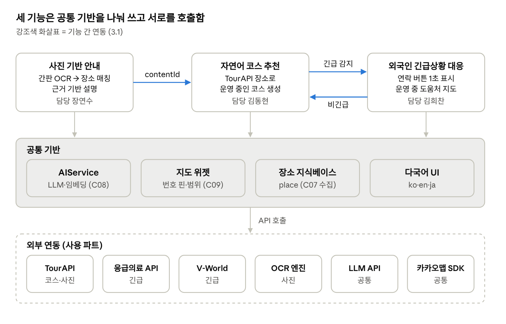
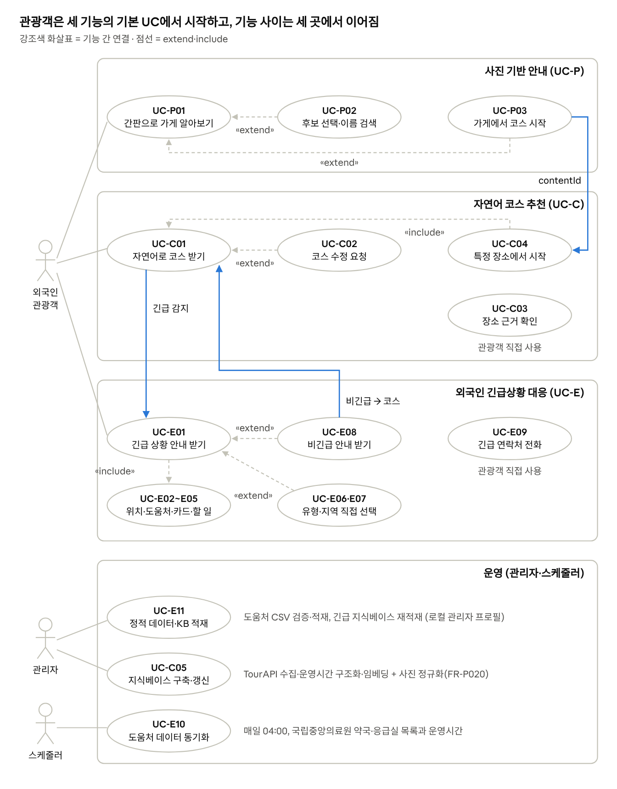
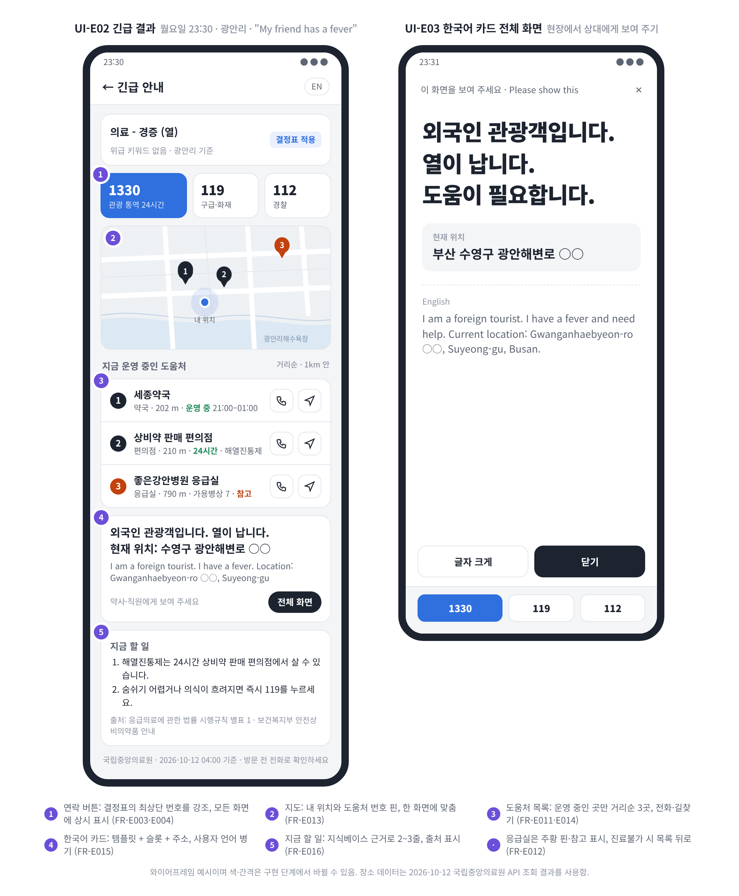

> **자동 변환본 — 직접 고치지 않음.** SRS (소프트웨어 요구사항 명세서) v1.4 Word 원본을 변환한 사본임.
> 바꿀 내용은 `docs/spec/PENDING.md`에 적고, Word 원본을 고친 뒤 이 스크립트로 다시 만듦. 규칙: `docs/spec/README.md`

**소프트웨어 요구사항 명세서**

Software Requirements Specification (SRS)

문서 코드: SRS

<table>
<colgroup>
<col />
<col />
</colgroup>
<thead>
<tr class="header">
<th>프로젝트명</th>
<th>부산 외국인 관광 안내 서비스</th>
</tr>
</thead>
<tbody>
<tr class="odd">
<td>팀명</td>
<td>소프트웨어공학 3조</td>
</tr>
<tr class="even">
<td>팀원</td>
<td>
김동현: 자연어 코스 추천

김희찬: 외국인 긴급상황 대응

장연수: 사진 기반 안내

손누리: 테스트·평가 (평가셋 구축, 테스트 케이스)
</td>
</tr>
<tr class="odd">
<td>버전</td>
<td>v1.4</td>
</tr>
<tr class="even">
<td>작성일</td>
<td>2026-10-15</td>
</tr>
<tr class="odd">
<td>담당교수</td>
<td>임한신</td>
</tr>
</tbody>
</table>

# 문서 관리

| **버전** | **날짜**   | **작성자** | **변경 내용**                                                                                                                                  |
|----------|------------|------------|------------------------------------------------------------------------------------------------------------------------------------------------|
| 0.1      | 2026-10-12 | 김동현     | 코스 추천 파트 초안 (FR-C001~C018)                                                                                                             |
| 0.1      | 2026-10-12 | 장연수     | 사진 기반 안내 파트 초안 (FR-P001~P021), 10/12 회의 뒤 수정본                                                                                  |
| 0.2      | 2026-10-12 | 김희찬     | 긴급상황 대응 파트 초안, 팀 규칙(ID 접두어 E, /api/v1, 공통 AIService) 반영                                                                    |
| 1.0      | 2026-10-12 | 김희찬     | 세 파트 통합, 공통 기준(4.1)과 기능 간 연동 요구사항(3.1) 정리                                                                                 |
| 1.1      | 2026-10-13 | 김희찬     | 표지(팀원·학번·담당교수)와 담당자 이름 정리                                                                                                    |
| 1.2      | 2026-10-13 | 김희찬     | 공통 기반을 팀 자체 개발로 기술, 2.1 구성도 담당자 표기·6.2 와이어프레임 수정, 오타 정리                                                       |
| 1.3      | 2026-10-15 | 장연수     | FR-P021(VLM 재독해) 삭제, FR-P006 반경 완화 단계(500m→1,500m→2개 구 전체) 추가, FR-P010 원문 상호 표시, DATA-P05·UI-P02 수정, 손누리 역할 기재 |
| 1.4      | 2026-10-15 | 김희찬     | 1.3 변경과 이어지는 UC-P01·AC-P01·테스트 분기·용어 정리, 중복 행 삭제, 전체 문장 개조식 변환                                                   |

# 1. 문서 개요 (Introduction)

## 1.1 목적 (Purpose)

본 문서는 부산 수영구(광안리)·해운대구를 찾은 외국인 관광객을 위한 안내 서비스의 요구사항을 정의함. 대상 독자는 팀원(구현·테스트), 담당 교수와 검토자임. 설계는 통합 SDD가 이 문서의 ID를 그대로 따름.

## 1.2 프로젝트 범위 (Scope)

서비스는 세 핵심 기능으로 구성되고, 모두 공공데이터를 근거로 답하며 LLM은 읽기·분류·요약에만 씀.

| 기능 (담당)                   | 해결하는 문제                                                                                                                                            | 핵심 서비스                                                                                                                                     |
|-------------------------------|----------------------------------------------------------------------------------------------------------------------------------------------------------|-------------------------------------------------------------------------------------------------------------------------------------------------|
| 자연어 코스 추천 (김동현)     | 한국어 지도 앱으로 장소를 골라 순서를 짜기 어렵고, 범용 챗봇은 실제 운영 여부와 이동 가능성을 보장하지 못함                                              | 자기 언어로 조건을 말하면 TourAPI 데이터만으로 방문일에 실제로 돌 수 있는 3~5곳 코스와 시간표를 제공함                                          |
| 사진 기반 안내 (장연수)       | 한글 간판만 있는 가게가 무엇인지 알기 어렵고, 번역 앱은 글자를 읽는 데서 끝남                                                                            | 간판 사진 한 장으로 TourAPI에 등록된 가게를 식별하고 그 데이터만 근거로 한·영·일 소개를 주며, 그 가게에서 코스를 시작하게 함                    |
| 외국인 긴급상황 대응 (김희찬) | 아프거나 물건을 잃거나 위협을 느낄 때 지금 어디로 가야 하는지 알기 어려움. 2026-10-12(월) 광안리해수욕장 1km 안 약국 39곳 중 23:30에 여는 곳은 1곳이었음 | 상황을 설명하면 112·119·1330 버튼을 즉시 보여주고, 지금 운영 중인 도움처를 지도에 띄우며, 현장용 한국어 문장 카드와 근거 기반 "지금 할 일"을 줌 |

- 대상 지역: 부산 수영구(광안리)·해운대구. 두 구의 데이터를 사전 적재하며, 범위 한정은 설계상 의도된 것임.

- 대상 언어: 한국어·영어·일본어 (UI와 결과 모두).

- 범위 제외 (공통): 로그인, 예약·결제, 실제 도로 경로 안내(턴바이턴), 중국어, 커뮤니티·코스 공유·랭킹, 외부 배포(로컬 시연).

- 범위 제외 (코스): 실시간 혼잡도.

- 범위 제외 (사진): 음식 사진 인식(확장 계획), 캡처 사진 길찾기, 웹 검색 실시간 폴백, 사진 저장·공유, 야간·세로·필기체 간판 인식 보장.

- 범위 제외 (긴급): 112·119 신고 대행과 자동 통화(전화 버튼으로 연결만), 의료 진단·약 추천, 실시간 위치 공유·보호자 알림, 통역 통화, 대상 지역 밖 도움처 안내.

## 1.3 용어 및 약어 (Definitions & Acronyms)

| 용어/약어                                     | 정의                                                                                                                                          |
|-----------------------------------------------|-----------------------------------------------------------------------------------------------------------------------------------------------|
| LLM / VLM                                     | Large Language / Vision-Language Model. 본 서비스는 LLM만 조건 추출·상황 분류·근거 요약·설명 생성에 사용하고 VLM은 사용하지 않음 (공통)       |
| RAG                                           | Retrieval-Augmented Generation. 지식베이스 문서를 검색해 그 내용만 근거로 문장을 만드는 방식 (공통)                                           |
| 임베딩                                        | 문장을 뜻이 비슷하면 가까운 숫자 벡터로 바꾼 것 (bge-m3, 1024차원) (공통)                                                                     |
| AIService                                     | LLM 호출(complete)과 임베딩(embed)을 맡는 팀 공통 컴포넌트 (COMP-C08) (공통)                                                                  |
| TourAPI                                       | 한국관광공사가 공공데이터포털로 제공하는 관광정보 Open API (KorService2) (코스, 사진)                                                         |
| contentId                                     | TourAPI가 장소마다 부여하는 고유 번호. 공통 place 테이블의 장소 ID (코스, 사진)                                                               |
| 지식베이스(KB)                                | 장소 정보와 임베딩(코스), 또는 긴급 안내 문서와 임베딩(긴급)을 모아 둔 DB (코스, 긴급)                                                        |
| 코스 탐색기(Planner)                          | 제약을 만족하는 방문 순서를 찾는 직접 구현 모듈 (코스)                                                                                        |
| OPTW                                          | Orienteering Problem with Time Windows. 시간창 제약이 있는 방문지 선택·순서 문제 (코스)                                                       |
| 조건 완화(Relaxation)                         | 코스가 없을 때 정해진 순서로 제약을 하나씩 푸는 것 (코스)                                                                                     |
| OCR / 텍스트 블록                             | 이미지 안 글자를 텍스트로 바꾸는 기술 / OCR이 한 덩어리로 인식한 텍스트와 신뢰도 (사진)                                                       |
| 상호 정규화 / 자모 분해                       | 공백·기호 제거, 혼동 문자 치환으로 상호를 비교 가능하게 맞추는 것 / 한글 음절을 초·중·종성 단위로 푸는 것 (사진)                              |
| 반경 필터                                     | 사용자 위치 기준 반경(기본 500 m) 안의 장소만 후보로 삼는 것 (사진)                                                                           |
| Top-1 / Top-3                                 | 정답 가게가 점수 1위 / 상위 3위 안에 들어 있는 비율 (사진)                                                                                    |
| CONFIRMED / CANDIDATES / NOT_FOUND / OCR_FAIL | 사진 매칭 결과 4종: 확정 / 후보 선택 / 공식 데이터에 없음 / 문자 인식 실패 (사진)                                                             |
| 도움처                                        | 긴급 상황에서 찾아갈 수 있는 장소. 응급실, 약국, 상비약 판매 편의점, 지구대·파출소, 관광안내소 (긴급)                                         |
| 한국어 카드                                   | 현재 상황과 위치를 한국어 문장으로 만들어 약사·경찰·택시 기사에게 화면으로 보여주는 기능 (긴급)                                               |
| 위급 키워드                                   | 법정 응급증상(응급의료에 관한 법률 시행규칙 별표 1)을 바탕으로 만든 한·영·일 단어 목록. 코스 요청의 긴급 감지에도 같은 사전을 씀 (긴급, 코스) |
| 운영 중 판정                                  | 요일별 운영시간과 현재(또는 도착) 시각으로 장소가 열려 있는지 판단하는 규칙 (코스, 긴급)                                                      |
| 결정표                                        | 긴급 상황 유형별로 안내할 장소 종류와 대체 순서를 정의한 표 (3.4.1) (긴급)                                                                    |
| 안전상비의약품                                | 약국 외 24시간 연중무휴 점포에서 팔 수 있도록 지정된 일반의약품 (해열진통제·감기약·소화제·파스) (긴급)                                        |
| hvec                                          | 국립중앙의료원 API의 응급실 실시간 가용병상 수 필드 (긴급)                                                                                    |
| EPSG:5174                                     | 지방행정 인허가 데이터가 쓰는 한국 좌표계. 위경도(WGS84)로 변환해 사용 (긴급)                                                                 |
| 로컬 관리자 프로필                            | 팀원이 로컬 PC에서만 켜는 실행 설정. 수집·적재·동기화 같은 관리자 기능은 이 프로필에서만 존재함 (공통)                                        |

## 1.4 ID 규칙

- 기능별 접두어: 코스 C, 사진 P, 긴급 E. 예: FR-C001, UC-P01, COMP-E05.

- 자릿수: FR·NFR·ERR·TC·AC는 요구사항 표 기준으로 파트별 초안을 그대로 둠. UC·UI·DATA·AI-REQ·COMP·API는 두 자리임.

- 팀 공통 컴포넌트(지식베이스 수집기 COMP-C07, AIService COMP-C08, 지도 위젯 COMP-C09)는 코스 파트 ID를 모든 파트가 그대로 참조함.

- 인수 기준 ID는 통합본에서 AC-C01, AC-P01, AC-E01 형식(두 자리)으로 맞춤.

# 2. 전체 설명 (Overall Description)

## 2.1 제품 관점 (Product Perspective)

세 기능은 하나의 Flutter Web 앱과 하나의 Spring Boot 백엔드를 공유하는 한 서비스이며, 팀이 새 저장소에서 직접 설계·개발함. 지도 위젯, 다국어 UI, 백엔드 계층 구조(Controller-Service-Repository)는 공통 기반으로 한 번 구현해 세 기능이 함께 씀.

- 공통 기반: 장소 지식베이스(TourAPI place, 코스·사진 공유), AIService(LLM·임베딩), 지도 위젯, 다국어 UI.

- 기능별 데이터: 코스는 장소 임베딩·구조화된 운영시간, 사진은 정규화 상호(name_norm), 긴급은 TourAPI에 없는 도움처(help_places)와 긴급 안내 지식베이스를 따로 둠.

- 기능 간 연결: 사진이 식별한 장소에서 코스를 시작하고(contentId → startPlaceId), 코스 요청에서 긴급 키워드가 감지되면 긴급 화면으로 넘기며, 긴급에서 비긴급으로 분류되면 코스 화면으로 안내함 (3.1).

- 외부 연동: TourAPI, 국립중앙의료원 약국·응급의료기관 API, V-World 주소 API, OCR 엔진(PoC 후 결정), LLM API(개발 Ollama, 시연 OpenAI), 카카오맵 JS SDK.

그림 2-1. 시스템 구성 — 세 기능은 공통 기반 네 가지를 함께 쓰고, 기능 사이의 연동은 세 개의 화살표(사진→코스, 코스→긴급, 긴급→코스)뿐임.

## 2.2 대상 사용자 (Target Users)

| 사용자 유형               | 특징                                                                                                                  | 주요 목표                                                                      | 권한/제약                                            |
|---------------------------|-----------------------------------------------------------------------------------------------------------------------|--------------------------------------------------------------------------------|------------------------------------------------------|
| 외국인 관광객 (주 사용자) | 부산 초행, 한국어 불가, 단기 체류, 휴대폰 웹 사용. 페르소나: 아오이(일본인 27세, 광안리 2박 3일), 다니엘(영어 사용자) | 코스 받기, 간판 가게 알아보기, 긴급 시 갈 곳 찾기                              | 로그인 없음. 위치·카메라는 요청 때마다 사용자가 허용 |
| 동행자                    | 환자·피해자 대신 앱을 조작하는 일행                                                                                   | 긴급 안내를 대신 받기                                                          | 로그인 없음                                          |
| 관리자 (팀)               | 서비스 운영자                                                                                                         | 지식베이스 수집·갱신, 정규화 컬럼 생성, 도움처·긴급 지식베이스 적재, 평가 실행 | 로컬 관리자 프로필에서만 실행                        |
| 스케줄러 (시스템 액터)    | 매일 1회 자동 실행                                                                                                    | 약국·응급실 정보를 최신으로 유지                                               | 시스템 내부 실행                                     |

## 2.3 운영 환경 (Operating Environment)

- Client: Flutter Web 빌드. Chrome·Edge 최신 버전과 모바일 Chrome·Safari, 화면 폭 360px 이상. 카메라·갤러리 입력과 브라우저 위치 권한은 localhost 또는 HTTPS에서만 동작함.

- Server: 팀원 로컬 PC, Java 17, Spring Boot 4.0.x, Docker Compose(DB, 로컬 OCR 엔진을 쓰면 컨테이너 1개 추가).

- External AI/API: AIService 경유 LLM(개발 Ollama, 시연 OpenAI)과 임베딩 bge-m3, TourAPI, 국립중앙의료원 API, V-World 주소 API, OCR 엔진, 카카오맵 JS SDK.

- Database: PostgreSQL + pgvector (공통 place, 코스 임베딩, 도움처·운영시간, 긴급 지식베이스).

## 2.4 제약사항 (Constraints)

- 부산 지역 관련 데이터의 출처 및 이용조건을 명시할 것

- 개인정보 수집을 최소화할 것

- LLM/VLM 단순 1회 호출만으로 구성하지 않을 것

- 실제 결제/예약은 범위 밖으로 둘 수 있음

- 본 서비스의 추가 제약사항은 아래 표와 같음.

| 구분      | 제약                                                                                                     | 관련 파트  |
|-----------|----------------------------------------------------------------------------------------------------------|------------|
| 호출 한도 | TourAPI 일일 호출 한도 안에서 수집함 (수치는 PoC에서 확정)                                               | 코스, 사진 |
| 호출 한도 | 국립중앙의료원 API는 개발계정 기준 오퍼레이션별 하루 1,000건임                                           | 긴급       |
| 호출 한도 | OCR은 무료 한도 안에서 평가·시연함 (한도는 PoC에서 확정)                                                 | 사진       |
| 이용 조건 | 카카오 로컬 API 응답은 저장하거나 LLM에 넣지 않음. 도움처 좌표 변환은 V-World를 씀                       | 공통       |
| 이용 조건 | TourAPI 개요 원문은 바꾸지 않고 출처(ⓒ한국관광공사)를 표시하며, LLM 설명은 생성된 안내문으로 따로 표시함 | 코스, 사진 |
| 개인정보  | 사진·위치 좌표·긴급 입력 문장은 서버에 저장하지 않음                                                     | 공통       |
| 개인정보  | 클라우드 OCR을 쓰면 사진이 외부로 전송되므로 사용 전 안내하고, 로컬 실행 엔진을 우선 검토함              | 사진       |
| 데이터    | 후보 장소는 사전 적재한 TourAPI DB로만 찾고, 매칭 시점에 웹 검색 같은 실시간 조회는 하지 않음            | 사진       |
| 안전      | 의료 진단이나 약 이름·용량 권고를 하지 않음. 안내는 장소·연락처·공식 안내 수준으로 제한함                | 긴급       |
| 비용      | 시연용 OpenAI 비용은 팀이 정한 월 한도 안에서 씀                                                         | 공통       |
| 범위      | 대상 지역은 수영구·해운대구로 한정함 (팀 결정, DB 무료 한도 고려)                                        | 공통       |
| 일정      | 중간발표(2026-10-27·29)까지 명세·설계, 구현은 이후 진행함                                                | 공통       |

## 2.5 가정 및 의존성 (Assumptions & Dependencies)

1\. TourAPI의 운영시간·휴무일과 국립중앙의료원의 약국 운영시간은 수집 시점 기준이며 실제와 다를 수 있음. 화면에 '방문 전 확인' 문구를 둠.

2\. 도보 이동시간은 직선거리 기반 근사치임.

3\. 사진 기능은 사전 적재된 TourAPI DB에 등록된 가게만 식별할 수 있고, 간판 상호가 등록 상호와 같거나 자모 수준으로 비슷함. 등록률은 PoC에서 측정함.

4\. 사용자는 정면에서 가로 간판을 촬영함.

5\. 사진 기능은 식별한 장소를 TourAPI contentId로 코스 기능에 넘김.

6\. 안전상비의약품 판매자는 24시간 연중무휴 점포라는 현행 등록 요건이 유지됨.

7\. 112 외국어 통역 운영 시간은 출처 간 차이가 있어 경찰청 공식 안내로 재확인함. 치안센터는 상시 근무가 확인될 때까지 도움처에서 제외함.

8\. 팀 공통 AIService는 호출별 타임아웃·재시도 횟수 지정을 지원함 (긴급 기능의 예외 기준, 4.1).

9\. 외부 API(TourAPI, 국립중앙의료원, V-World, LLM, OCR)는 정상 제공된다고 가정하고, 장애 시 각 기능의 대체 경로로 대응함.

# 3. 기능 요구사항 (Functional Requirements)

기능 요구사항은 60개임: 코스 18개(FR-C001~C018), 사진 20개(FR-P001~P020), 긴급 22개(FR-E001~E022). 임계값·반경·개수 같은 숫자는 설정값이며 PoC 뒤 확정함.

### 3.1 기능 간 연동 요구사항

다른 파트와 주고받는 요구사항은 4개이며, 양쪽 문서가 같은 값을 주고받도록 맞췄음.

| 연동        | 보내는 쪽 | 받는 쪽 | 넘기는 값                                                                      | 규칙                                                                                                                                       |
|-------------|-----------|---------|--------------------------------------------------------------------------------|--------------------------------------------------------------------------------------------------------------------------------------------|
| 사진 → 코스 | FR-P015   | FR-C014 | 확정 장소의 contentId (startPlaceId)                                           | 코스는 그 장소를 1번으로 고정함. 조건에 맞지 않으면 코스의 조건 완화 규칙(FR-C007)을 따름                                                  |
| 코스 → 긴급 | FR-C013   | FR-E001 | 긴급 전환 신호(notice type=EMERGENCY), 요청 원문과 위치는 화면 메모리로만 전달 | 긴급 감지는 긴급 파트의 위급 키워드 사전(DATA-E10) 하나만 씀. 긴급으로 판정된 요청은 코스 기록(DATA-C07)에 저장하지 않고 URL에도 넣지 않음 |
| 긴급 → 코스 | FR-E018   | FR-C001 | 없음 (화면 이동만)                                                             | 비긴급으로 분류되면 "관광 코스 찾기" 버튼으로 코스 요청 화면을 엶. 입력 문장은 넘기지 않음                                                 |
| 수집 공유   | FR-C017   | FR-P020 | 공통 place 행                                                                  | 사진은 코스가 수집한 place에 정규화 상호(name_norm)만 더함. 수집 후 정규화를 다시 실행함                                                   |

### 3.2 자연어 코스 추천 (FR-C)

| ID      | 요구사항명      | 요구사항 내용                                                                                                                                                        | 우선순위 | 검증 방법         | 비고                |
|---------|-----------------|----------------------------------------------------------------------------------------------------------------------------------------------------------------------|----------|-------------------|---------------------|
| FR-C001 | 코스 요청 입력  | 사용자는 한국어·영어·일본어 중 하나로 500자 이하의 코스 요청을 입력할 수 있어야 함. 500자를 넘으면 전송하지 않고 안내함                                              | Must     | Test              | UI-C01              |
| FR-C002 | 조건 추출       | 시스템은 요청에서 방문일, 시작 시각, 소요시간, 권역, 카테고리, 실내 여부, 취향 문장을 추출해 CourseIntent로 만들어야 함                                              | Must     | Test(평가셋)      | AI-REQ-C04          |
| FR-C003 | 가정 표시·수정  | 요청에 없는 조건은 기본값(방문일 오늘, 시작 현재 시각, 소요 4시간, 권역 전체)을 쓰고 화면에 칩으로 표시해야 함. 사용자는 칩을 눌러 값을 바꿀 수 있어야 함            | Must     | Test              |                     |
| FR-C004 | 후보 필터       | 시스템은 권역·카테고리가 맞지 않거나 방문 요일이 휴무일인 장소를 후보에서 제외해야 함                                                                                | Must     | Test              |                     |
| FR-C005 | 의미 검색       | 시스템은 필터를 통과한 장소 중 취향 문장과 임베딩 유사도가 높은 상위 15곳을 반환해야 함. 요청 언어와 무관하게 한국어 데이터에서 검색함                               | Must     | Test              | AI-REQ-C05          |
| FR-C006 | 코스 생성       | 시스템은 후보 중 3~5곳을 골라 순서를 정해야 함. 모든 장소는 도착~출발 시간에 운영 중이어야 하고, 마지막 출발 시각은 시작 시각 + 소요시간을 넘지 않아야 함            | Must     | Test(단위·평가셋) | 핵심                |
| FR-C007 | 조건 완화       | 제약을 만족하는 코스가 없으면 정해진 4단계 순서로 제약을 푸는 것을 반복하고 푼 항목을 표시해야 함. 끝까지 없으면 불가 사유와 조건 변경 제안을 표시함                 | Must     | Test              |                     |
| FR-C008 | 지도 표시       | 코스 장소를 번호 핀과 순서선으로 지도에 표시해야 함                                                                                                                  | Must     | Test(UI)          | 공통 지도 위젯      |
| FR-C009 | 시간표 표시     | 장소별 도착·출발 시각, 이전 장소에서의 이동 수단·시간을 표시해야 함. 운영시간이 불확실한 장소에는 '방문 전 확인' 배지를 붙여야 함                                    | Must     | Test(UI)          |                     |
| FR-C010 | 코스 설명       | 시스템은 확정된 코스에 대해 요청 언어로 코스 제목과 장소별 설명(60자 이내)을 생성해야 함. 설명은 지도·시간표가 표시된 뒤 추가로 표시함                               | Must     | Test              | AI-REQ-C01          |
| FR-C011 | 근거 카드       | 장소를 누르면 TourAPI 개요 원문, 운영시간 원문, 대표 이미지, 출처(ⓒ한국관광공사), 수집일을 표시해야 함                                                               | Must     | Review            | 사진 FR-P010과 공유 |
| FR-C012 | 범위 밖 안내    | 대상 지역 밖 또는 관광과 무관한 요청에는 코스를 만들지 않고 지원 범위와 예시 질문을 안내해야 함                                                                      | Must     | Test              |                     |
| FR-C013 | 긴급 연결       | 요청에서 긴급 키워드가 감지되면 코스 생성을 멈추고 긴급상황 대응 기능으로 연결해야 함                                                                                | Must     | Test              | 3.1 코스→긴급       |
| FR-C014 | 출발 장소 지정  | 사용자는 지도에서 출발 장소를 고를 수 있어야 함. 다른 기능이 contentId를 넘기면 그 장소를 1번으로 고정해야 함                                                        | Should   | Test              | 3.1 사진→코스       |
| FR-C015 | 대화형 수정     | 사용자는 생성된 코스에 자연어 수정 요청을 보낼 수 있어야 함. 시스템은 요청을 수정 명령(REMOVE, REPLACE, ADD, SET_DURATION, KEEP)으로 바꿔 새 버전 코스를 만들어야 함 | Should   | Test              |                     |
| FR-C016 | 행사 반영       | 방문일에 진행 중인 대상 지역 행사를 후보에 포함해야 함                                                                                                               | Should   | Test              | 중간발표에는 계획만 |
| FR-C017 | 지식베이스 수집 | 관리자는 대상 지역·유형의 TourAPI 장소를 수집할 수 있어야 함. 호출 한도로 중단되면 다음 실행 때 미완료 장소부터 이어서 처리해야 함                                   | Must     | Test              | 로컬 관리자 프로필  |
| FR-C018 | 운영시간 구조화 | 시스템은 수집한 운영시간·휴무일 문장을 요일별 여는/닫는 시각과 휴무 요일로 변환해 저장해야 함. 변환하지 못하면 '불확실'로 표시함                                     | Must     | Test(표본 50)     | AI-REQ-C06          |

### 3.3 사진 기반 안내 (FR-P)

| ID      | 요구사항명                | 요구사항 내용                                                                                                                                                                                                                                                                       | 우선순위 | 검증 방법    | 비고                           |
|---------|---------------------------|-------------------------------------------------------------------------------------------------------------------------------------------------------------------------------------------------------------------------------------------------------------------------------------|----------|--------------|--------------------------------|
| FR-P001 | 사진 입력                 | 사용자는 카메라 촬영 또는 갤러리 선택으로 사진 1장을 업로드할 수 있어야 함                                                                                                                                                                                                          | Must     | Test         | UI-P01                         |
| FR-P002 | 사진 검증                 | JPG·PNG가 아니거나 10 MB를 넘는 사진은 전송하지 않고 이유를 안내해야 함                                                                                                                                                                                                             | Must     | Test         |                                |
| FR-P003 | 위치 입력                 | 사용자가 허용하면 요청 시점의 현재 위치를 1회 사용해야 함. 거부·실패 시 지도에서 위치를 지정하거나 대상 2개 구 전체를 후보로 쓰고 "정확도가 낮을 수 있음"을 표시해야 함                                                                                                             | Must     | Test         | NFR-P003                       |
| FR-P004 | 간판 문자 인식            | 사진에서 텍스트 블록(텍스트, 신뢰도)을 추출해야 함. 신뢰도 0.5 미만 블록은 매칭에서 제외함                                                                                                                                                                                          | Must     | Test(평가셋) | AI-REQ-P01                     |
| FR-P005 | 상호 정규화               | OCR 텍스트와 장소 이름에 같은 정규화 규칙을 적용해야 함                                                                                                                                                                                                                             | Must     | Test(단위)   |                                |
| FR-P006 | 후보 조회                 | 위치가 있으면 반경 500m 안, 없으면 대상 2개 구 안의 관광지(12)·문화시설(14)·쇼핑(38)·음식점(39)을 후보로 조회해야 함. 위치가 있고 1위 점수가 0.60 미만이면 반경을 설정된 단계(500m→1,500m→대상 2개 구 전체)로 넓혀 다시 조회하며, 마지막 단계까지 0.60 미만이면 NOT_FOUND로 판정함. | Must     | Test         | 공통 place                     |
| FR-P007 | 유사도 점수화             | 후보마다 자모 단위 유사도와 거리로 점수를 계산하고, 점수 내림차순(동점은 contentId 오름차순)으로 정렬해야 함                                                                                                                                                                        | Must     | Test(단위)   | AI-REQ-P01                     |
| FR-P008 | 결과 분기                 | 점수에 따라 CONFIRMED, CANDIDATES, NOT_FOUND, OCR_FAIL 중 하나로 응답해야 함. 임계값은 설정값임                                                                                                                                                                                     | Must     | Test         |                                |
| FR-P009 | 후보 선택                 | CANDIDATES이면 상위 3곳을 보여주고, 사용자가 1곳을 고르면 그 장소로 FR-P010을 수행해야 함                                                                                                                                                                                           | Must     | Test         | UI-P03                         |
| FR-P010 | 가게 정보 표시            | 한글 원문 상호(번역·음역하지 않고 원문 그대로), 업종, 주소, 운영시간, TourAPI 개요 원문과 출처(ⓒ한국관광공사)를 표시해야 함. 운영시간이 불확실하면 '방문 전 확인' 배지를 붙임                                                                                                       | Must     | Test/Review  | 코스 근거 카드(FR-C011)와 공유 |
| FR-P011 | 설명 생성                 | 확정된 장소의 TourAPI 원문만 근거로 요청 언어(한·영·일) 60자 이내 설명을 생성하고 정보 표시 뒤에 추가 표시해야 함. 설명은 '생성된 안내문'으로 원문과 구분함                                                                                                                         | Must     | Test(평가셋) | AI-REQ-P02                     |
| FR-P012 | 설명 검증·대체            | 설명에 입력 원문에 없는 장소명·숫자가 있거나 길이·언어가 맞지 않으면 설명을 버리고 템플릿 설명(상호·업종·주소)으로 대체해야 함                                                                                                                                                      | Must     | Test         | AI-REQ-P02, P03                |
| FR-P013 | 지도 표시                 | 확정 장소의 위치를 지도에 핀으로 표시해야 함                                                                                                                                                                                                                                        | Must     | Test(UI)     | 공통 지도 위젯                 |
| FR-P014 | 미등록·실패 안내          | NOT_FOUND이면 "공식 관광데이터에 없는 가게일 수 있다"는 안내를, OCR_FAIL이면 재촬영 안내를 표시해야 함                                                                                                                                                                              | Must     | Test         | UI-P04                         |
| FR-P015 | 코스 시작점 연동          | 확정 장소에서 "여기서 출발하는 코스"를 누르면 그 contentId를 코스 요청의 startPlaceId로 전달해야 함                                                                                                                                                                                 | Should   | Test         | 3.1 사진→코스                  |
| FR-P016 | 이름 직접 검색            | 사용자가 상호를 입력하면 정규화 후 같은 점수식(거리 제외)으로 후보 3곳을 보여줘야 함                                                                                                                                                                                                | Must     | Test         | UI-P04                         |
| FR-P017 | 다중 간판 후보            | 한 사진의 여러 텍스트 블록이 서로 다른 장소와 매칭되면 블록별 최고 장소를 후보 목록에 함께 보여줘야 함                                                                                                                                                                              | Should   | Test         |                                |
| FR-P018 | 외부 지도앱 열기          | 확정 장소의 좌표로 카카오맵 링크를 열 수 있어야 한다(도로 경로는 직접 그리지 않음)                                                                                                                                                                                                  | Could    | Test         | 링크 형식 확인 필요            |
| FR-P019 | 매칭 로그                 | 평가를 위해 OCR 텍스트(전화번호 마스킹), 후보 점수, 결과 분기, 선택한 contentId를 기록해야 함. 사진과 좌표는 기록하지 않음                                                                                                                                                          | Should   | Test/Review  | NFR-P003                       |
| FR-P020 | 정규화 컬럼 생성 (관리자) | 관리자는 지식베이스 수집 뒤 모든 장소의 name_norm을 생성·갱신할 수 있어야 함. 정규화 규칙이 바뀌면 전체를 다시 생성함                                                                                                                                                               | Must     | Test         | 3.1 수집 공유 (FR-C017)        |

### 3.4 외국인 긴급상황 대응 (FR-E)

| ID      | 요구사항명         | 요구사항 내용                                                                                                                                                                   | 우선순위 | 검증 방법    | 비고                                    |
|---------|--------------------|---------------------------------------------------------------------------------------------------------------------------------------------------------------------------------|----------|--------------|-----------------------------------------|
| FR-E001 | 상황 입력          | 사용자는 로그인 없이 상황을 자유 문장(최대 500자)으로 입력할 수 있어야 함. 한국어·영어·일본어 입력을 지원하고, 코스 기능에서 넘어온 입력은 미리 채워진 상태로 엶                | Must     | Test         | 3.1 코스→긴급                           |
| FR-E002 | 위치 확인          | 시스템은 브라우저 위치 권한을 요청하고, 거부되면 "광안리"·"해운대" 중 하나를 선택하게 해야 함                                                                                   | Must     | Test         |                                         |
| FR-E003 | 즉시 연락 버튼     | 시스템은 입력 제출 후 LLM 응답을 기다리지 않고 112·119·1330 버튼을 표시해야 하며, 위급 키워드가 감지되면 해당 번호(119 또는 112)를 맨 위에 강조해야 함                          | Must     | Test         | NFR-E001                                |
| FR-E004 | 상시 연락 버튼     | 긴급 안내의 모든 화면(오류 화면 포함)에 112·119·1330 버튼이 항상 보여야 함                                                                                                      | Must     | Review, Test |                                         |
| FR-E005 | 위급 키워드 판정   | 시스템은 법정 응급증상을 바탕으로 만든 한·영·일 위급 키워드 사전으로 입력을 검사해 위급 여부를 판정해야 함                                                                      | Must     | Test         | DATA-E10, 코스 FR-C013도 같은 사전 사용 |
| FR-E006 | 상황 분류          | 시스템은 LLM으로 입력을 7개 유형(의료-위급, 의료-경증, 분실·도난, 위협·범죄, 화재·재난, 길 잃음·언어, 비긴급), 긴급도, 슬롯값(증상·분실물·상황)으로 분류해야 함                 | Must     | AI Eval      | AI-REQ-E01·E02                          |
| FR-E007 | 최종 긴급도        | LLM 결과와 키워드 결과 중 하나라도 위급이면 위급으로 확정해야 함                                                                                                                | Must     | Test(결정표) |                                         |
| FR-E008 | 유형 직접 선택     | 분류 신뢰도가 기준값(초기 0.6) 미만이거나 LLM이 실패하면, 시스템은 7개 유형 버튼을 보여주고 사용자가 고르게 해야 함                                                             | Must     | Test         |                                         |
| FR-E009 | 장소 종류 결정     | 시스템은 3.4.1 결정표에 따라 유형별로 안내할 장소 종류와 대체 순서를 정해야 함                                                                                                  | Must     | Test(결정표) |                                         |
| FR-E010 | 운영 중 판정       | 시스템은 요일별 운영시간으로 현재 운영 여부를 판정해야 함. 24시를 넘는 종료 시각(예: 2500)은 다음날로, 공휴일은 공휴일 운영시간으로, 운영시간 정보가 없으면 "미확인"으로 처리함 | Must     | Test(경계값) | 실데이터에서 2500 표기 확인             |
| FR-E011 | 도움처 검색        | 시스템은 운영 중인 도움처를 반경 1km 안에서 거리순 최대 3곳 찾아야 하며, 없으면 3km로 넓히고, 그래도 없으면 결정표의 대체 장소를 찾아야 함                                      | Must     | Test         |                                         |
| FR-E012 | 응급실 실시간 정보 | 응급실을 안내할 때 가용병상 수와 유효 기간 안의 진료불가 메시지를 표시해야 하며, "응급실 진료불가" 메시지가 있는 병원은 목록 뒤로 보내고 경고를 붙여야 함                       | Must     | Test         | 2026-10-12 해운대백병원 사례            |
| FR-E013 | 지도 표시          | 시스템은 현재 위치와 도움처를 지도에 번호 핀으로 표시하고 모두 한 화면에 들어오게 범위를 맞춰야 함                                                                              | Must     | Test         | 공통 지도 위젯                          |
| FR-E014 | 전화·길찾기        | 각 도움처에는 이름, 거리, 오늘 운영시간, 전화 걸기, 길찾기 버튼이 있어야 함                                                                                                     | Must     | Test         |                                         |
| FR-E015 | 한국어 카드        | 시스템은 유형별 템플릿에 슬롯값과 현재 주소를 넣어 한국어 문장 카드를 만들고 사용자 언어 번역을 함께 보여줘야 함. 카드는 전체 화면으로 키울 수 있어야 함                        | Must     | Test, Review | AI-REQ-E07                              |
| FR-E016 | 지금 할 일         | 시스템은 지식베이스 문서만 근거로 "지금 할 일"을 2~3줄 보여주고 출처를 표시해야 함. 근거가 없으면 생성하지 않고 저장된 기본 문구를 표시함                                       | Must     | AI Eval      | AI-REQ-E03                              |
| FR-E017 | 대상 지역 밖       | 위치가 수영구·해운대구 밖이면 도움처 대신 112·119·1330 안내만 보여줘야 함                                                                                                       | Must     | Test         |                                         |
| FR-E018 | 비긴급 안내        | 비긴급으로 분류되면 1330(관광통역안내)을 맨 위에 두고, 관광 질문이면 코스 추천 화면으로 이동하는 버튼을 보여줘야 함. 입력 문장은 넘기지 않음                                    | Should   | Test         | 3.1 긴급→코스                           |
| FR-E019 | 데이터 동기화      | 시스템은 매일 1회 국립중앙의료원 API에서 대상 구의 약국·응급실 목록과 운영시간을 받아 저장해야 함                                                                               | Must     | Test         |                                         |
| FR-E020 | 실시간 정보 캐시   | 응급실 가용병상과 메시지는 요청 시 조회하고 5분간 캐시해야 함                                                                                                                   | Must     | Test         |                                         |
| FR-E021 | 정적 데이터 적재   | 관리자는 로컬 관리자 프로필에서 지구대·파출소, 관광안내소, 상비약 판매 편의점 CSV를 검증(dryRun) 후 적재해 도움처를 갱신할 수 있어야 함                                         | Should   | Test         | FR-C017과 같은 실행 방식                |
| FR-E022 | 지식베이스 반영    | 관리자는 저장소의 지식베이스 문서·위급 키워드·카드 템플릿 파일을 수정한 뒤 로컬 관리자 프로필에서 다시 적재할 수 있어야 하며, 바뀜 문서는 임베딩을 다시 만듦                    | Should   | Review, Test | 별도 관리자 화면 없음                   |

#### 3.4.1 상황 유형별 안내 결정표 (FR-E009 상세)

각 행이 그대로 테스트 케이스가 되며, 결정표는 코드가 아니라 설정 데이터로 관리한다(NFR-E009). 대체 순서는 FR-E011의 반경 확대(1km→3km) 뒤에 적용함.

| 상황 유형           | 예시 입력                                                        | 최상단 버튼              | 1순위 도움처                             | 1순위가 없을 때 / 함께 표시                      |
|---------------------|------------------------------------------------------------------|--------------------------|------------------------------------------|--------------------------------------------------|
| 의료-위급           | 의식 없음, 숨쉬기 어려움, 멈추지 않는 출혈, 얼굴이 붓는 알레르기 | 119                      | 응급실 (병상 표시, 진료불가 병원은 뒤로) | 119 안내만                                       |
| 의료-경증 (일반)    | 열, 두통, 소화불량, 근육통                                       | 1330                     | 운영 중 약국                             | 상비약 판매 편의점 / 응급실 위치 참고 표시       |
| 의료-경증 (약 필요) | 복통·설사, 가벼운 상처, 두드러기                                 | 1330                     | 운영 중 약국                             | 응급실 (편의점에 설사약·연고 없음)               |
| 분실·도난           | 지갑·여권 분실, 소매치기                                         | 112 (도난) / 1330 (분실) | 지구대·파출소 (24시간)                   | 운영 중 관광안내소 함께 표시                     |
| 위협·범죄           | 누가 따라옴, 폭행, 추행                                          | 112                      | 지구대·파출소                            | 사람이 있는 24시간 편의점 함께 표시              |
| 화재·재난           | 불, 연기, 지진해일 경보                                          | 119                      | (장소 안내 없음)                         | 대피 요령만 표시                                 |
| 길 잃음·언어        | 숙소를 못 찾음, 말이 안 통함                                     | 1330                     | 운영 중 관광안내소                       | 지구대·파출소 (관광안내소는 19시 전후 모두 닫음) |
| 비긴급              | 식당 예약 방법, 노포 영업시간 문의                               | 1330                     | (장소 안내 없음)                         | 코스 추천 화면 이동 버튼                         |

# 4. 비기능 요구사항 (Non-functional Requirements)

비기능 요구사항은 29개임: 코스 9개, 사진 9개, 긴급 11개. 세 파트가 같은 성격의 항목은 4.1의 팀 공통 기준을 따르고, 기준과 다른 값은 예외로 이유를 적었음. 수치는 모두 제안값이며 PoC 뒤 확정함.

### 4.1 팀 공통 기준

| 항목            | 공통 기준                                                                                                                      | 파트별 ID                         | 예외와 이유                                                                                      |
|-----------------|--------------------------------------------------------------------------------------------------------------------------------|-----------------------------------|--------------------------------------------------------------------------------------------------|
| 응답 구조       | 핵심 결과(지도·목록·정보)를 먼저 보여주고, LLM이 쓰는 설명은 뒤에 채움 (분리 API)                                              | NFR-C001, NFR-P001, NFR-E001·E002 | 긴급은 연락 버튼을 LLM 없이 1초 안에 먼저 보여줌                                                 |
| LLM 장애 대응   | 모든 LLM 호출은 AIService를 거치고, 실패해도 대체 경로로 화면을 반드시 표시함. 기본값은 8초 초과 시 1회 재시도                 | NFR-C002, NFR-P004, NFR-E003      | 긴급은 5초, 재시도 0회. 위급 상황에서 16초 대기는 길고, 키워드 판정과 유형 버튼이 대체 경로가 됨 |
| 개인정보        | 로그인·기기 위치 저장 없음. 요청 로그는 전화번호·이메일을 마스킹하고 30일 후 삭제함. 사진은 메모리에서만 처리함                | NFR-C003, NFR-P002·P003, NFR-E004 | 긴급은 입력 문장 자체를 저장하지 않는다(건강·범죄 관련 민감 정보)                                |
| 브라우저 호환성 | Chrome·Edge 최신 버전과 모바일 Chrome·Safari, 화면 폭 360px에서 핵심 화면이 깨지지 않음                                        | NFR-C004, NFR-P009, NFR-E011      | 없음 (통합하며 세 파트 값을 합침)                                                                |
| 다국어          | UI 문구와 결과를 한국어·영어·일본어로 표시함                                                                                   | NFR-P009, NFR-E006, AI-REQ-C05    | 없음                                                                                             |
| 유지보수성      | LLM은 설정값만 바꿔 Ollama ↔ OpenAI로 교체함. 가중치·임계값·규칙은 코드가 아닌 설정 파일이나 데이터로 둠                       | NFR-C005, NFR-P005, NFR-E009      | 없음                                                                                             |
| 재현성·테스트   | 규칙 모듈(코스 탐색기, 정규화·점수화, 운영 중 판정·결정표)은 같은 입력에 같은 결과를 내고 단위 테스트 라인 커버리지 80% 이상임 | NFR-C006, NFR-P006                | 긴급 규칙 모듈에도 같은 기준을 적용함 (통합하며 추가)                                            |
| 로그·모니터링   | LLM 호출마다 단계, 모델, 지연시간, 성공 여부, 토큰 수를 기록함 (본문 제외)                                                     | NFR-C007, NFR-P008                | 긴급은 유형·긴급도·처리시간·대체 경로만 남김 (NFR-E004)                                          |
| 호출 한도·비용  | 외부 API는 한도 안에서 배치·캐시로 쓰고, OpenAI 비용은 팀 월 한도를 넘지 않음                                                  | NFR-C009, NFR-P007, NFR-E007      | 없음                                                                                             |

### 4.2 자연어 코스 추천 (NFR-C)

| ID       | 요구사항명           | 요구사항 내용                                                                                                                             | 우선순위 | 검증 방법           | 비고                       |
|----------|----------------------|-------------------------------------------------------------------------------------------------------------------------------------------|----------|---------------------|----------------------------|
| NFR-C001 | 응답시간             | 코스(지도·시간표) 응답은 평가 질의 30개 기준 90%가 5초 이내, 설명 응답은 90%가 10초 이내여야 한다(OpenAI, 로컬 PC 기준)                   | Must     | Test(3회 반복 측정) | 설명 분리로 체감 시간 단축 |
| NFR-C002 | 가용성·오류 복구     | LLM 호출이 실패하거나 8초를 넘기면 1회 재시도하고, 그래도 실패하면 대체 경로(규칙 파서, 템플릿 설명)로 코스를 반환해야 함                 | Must     | Test(장애 주입)     |                            |
| NFR-C003 | 개인정보 보호        | 로그인과 기기 위치 수집을 하지 않음. 요청 로그는 전화번호·이메일을 마스킹해 저장하고 30일 후 삭제함. 긴급으로 판정된 요청은 저장하지 않음 | Must     | Review/Test         | 3.1 코스→긴급              |
| NFR-C004 | 브라우저 호환성      | Chrome·Edge 최신 버전과 모바일 Chrome·Safari, 화면 폭 360px에서 핵심 화면이 깨지지 않아야 함                                              | Should   | Test                | 4.1 공통 기준              |
| NFR-C005 | 유지보수성           | 생성 LLM은 설정값만 바꿔 Ollama ↔ OpenAI로 교체할 수 있어야 함. 점수 가중치·체류시간은 설정 파일에 둠                                     | Must     | Review              | 임베딩 모델은 고정         |
| NFR-C006 | 재현성·테스트 가능성 | 코스 탐색기는 같은 입력에 항상 같은 코스를 반환해야 함. 탐색기 단위 테스트 라인 커버리지는 80% 이상이어야 함                              | Must     | Test(JaCoCo)        |                            |
| NFR-C007 | 로그·모니터링        | LLM 호출마다 단계, 모델, 지연시간, 성공 여부, 토큰 수를 기록해야 함                                                                       | Should   | Review              | 평가·비용 산출             |
| NFR-C008 | 데이터 최신성        | 근거 카드에 수집일을 표시하고, 개발 기간 중 주 1회 수정된 장소만 재수집함                                                                 | Should   | Review              |                            |
| NFR-C009 | 비용                 | 시연·평가에 쓰는 OpenAI 비용은 팀이 정한 월 한도를 넘지 않아야 하며, 플랫폼 사용량 한도를 설정해 둠                                       | Should   | Review              | 한도 금액은 팀 결정        |

### 4.3 사진 기반 안내 (NFR-P)

| ID       | 요구사항명           | 요구사항 내용                                                                                                                                | 우선순위 | 검증 방법                 | 비고                 |
|----------|----------------------|----------------------------------------------------------------------------------------------------------------------------------------------|----------|---------------------------|----------------------|
| NFR-P001 | 응답시간             | 사진 업로드부터 식별 결과(정보·지도) 표시까지 평가 사진셋 기준 90%가 5초 이내, 설명 응답은 90%가 10초 이내여야 한다(로컬 PC 기준)            | Must     | Test(3회 반복 측정)       | 식별과 설명 API 분리 |
| NFR-P002 | 사진 비저장          | 업로드된 사진은 메모리에서만 처리하고 응답 후 폐기해야 함. 디스크·DB·로그에 사진이 남는 건수는 0이어야 하며 EXIF는 읽지 않음                 | Must     | Review/Test(파일·DB 점검) | AI-REQ-P04           |
| NFR-P003 | 위치·로그 개인정보   | 사용자 좌표는 요청 처리에만 쓰고 저장하지 않아야 함. 매칭 로그의 OCR 텍스트에서 전화번호·이메일을 마스킹하고 30일 후 삭제해야 함             | Must     | Review/Test               | NFR-C003과 통일      |
| NFR-P004 | 가용성·오류 복구     | OCR 또는 LLM 호출이 실패하거나 8초를 넘기면 1회 재시도하고, 그래도 실패하면 OCR은 재촬영·이름 검색 안내로, LLM은 템플릿 설명으로 대체해야 함 | Must     | Test(장애 주입)           | AI-REQ-P03           |
| NFR-P005 | 유지보수성           | OCR 엔진은 설정값 변경만으로 교체 가능해야 함. 매칭 가중치·임계값·반경은 설정 파일에 둠                                                      | Must     | Review                    | OcrEngine 인터페이스 |
| NFR-P006 | 재현성·테스트 가능성 | 정규화·점수화·분기는 DB·네트워크 없는 순수 함수로 구현해 같은 입력에 같은 결과를 내야 하며, 단위 테스트 라인 커버리지 80% 이상이어야 함      | Must     | Test(JaCoCo)              | NFR-C006과 통일      |
| NFR-P007 | 호출 한도·비용       | 클라우드 OCR을 쓸 경우 일 호출 상한을 설정하고 초과 시 안내해야 함. 시연 OpenAI 비용은 팀 월 한도를 넘지 않아야 함                           | Should   | Review                    | PoC에서 한도 확정    |
| NFR-P008 | 로그·모니터링        | 단계별(OCR, 매칭, 설명) 지연시간과 성공 여부를 기록해야 함                                                                                   | Should   | Review                    | 평가·비용 산출       |
| NFR-P009 | 호환성·사용성        | Chrome·Edge 최신 버전과 모바일 Chrome·Safari, 화면 폭 360px에서 카메라 입력을 포함한 핵심 화면이 깨지지 않고 UI 문구가 한·영·일로 나와야 함  | Should   | Test                      | 4.1 공통 기준        |

### 4.4 외국인 긴급상황 대응 (NFR-E)

| ID       | 요구사항명         | 요구사항 내용                                                                                                                               | 우선순위 | 검증 방법            | 비고                          |
|----------|--------------------|---------------------------------------------------------------------------------------------------------------------------------------------|----------|----------------------|-------------------------------|
| NFR-E001 | 즉시 응답          | 입력 제출 후 연락 버튼 표시까지 1초 이내 (로컬 환경 20회 측정 중 최대값)                                                                    | Must     | Test                 | 2단계 API                     |
| NFR-E002 | 전체 응답시간      | 상세 안내 전체 응답 p95 8초 이내 (LLM 포함, 평가셋 60문장)                                                                                  | Should   | Test                 |                               |
| NFR-E003 | 장애 시 동작       | LLM·공공 API가 응답하지 않아도 저장된 도움처와 연락 버튼으로 안내를 계속해야 함. LLM 호출은 5초 타임아웃, 재시도 0회임                      | Must     | Test(장애 주입)      | 4.1 예외                      |
| NFR-E004 | 개인정보 보호      | 입력 문장과 위치는 DB·로그에 저장하지 않음. 요청 로그에는 유형·긴급도·처리시간·대체 경로만 남김. 위치·주소는 LLM에 보내지 않음              | Must     | Review, Test         |                               |
| NFR-E005 | 비로그인 사용      | 긴급 안내는 로그인 없이 사용 가능해야 함. 관리자 API는 로컬 관리자 프로필에서만 등록되어 시연 실행에는 존재하지 않아야 함                   | Must     | Test                 | 팀 공통 방침                  |
| NFR-E006 | 다국어             | UI와 결과를 한국어·영어·일본어로 표시함                                                                                                     | Must     | Review               | 4.1 공통 기준                 |
| NFR-E007 | 호출 한도 준수     | 국립중앙의료원 API 호출은 오퍼레이션별 하루 1,000건 이내 (배치·캐시로 요청당 최대 1건)                                                      | Must     | Test(로그 집계)      |                               |
| NFR-E008 | 데이터 신선도·출처 | 약국·응급실 정보는 24시간 이내 갱신하고, 화면에 기준 시각과 출처를 표시함                                                                   | Must     | Review               |                               |
| NFR-E009 | 유지보수성         | 결정표, 위급 키워드, 상비약 품목, 카드 템플릿은 코드 수정 없이 데이터로 바꿀 수 있어야 함. 규칙 모듈 단위 테스트 라인 커버리지는 80% 이상임 | Should   | Review, Test(JaCoCo) | 상비약 품목 2026-12 확대 예정 |
| NFR-E010 | 사용성             | 연락 버튼은 최소 48×48px, 한국어 카드는 전체 화면에서 24pt 이상                                                                             | Should   | Review               |                               |
| NFR-E011 | 호환성             | Chrome·Edge 최신 버전과 모바일 Chrome·Safari, 화면 폭 360px에서 동작함                                                                      | Must     | Test                 | 4.1 공통 기준                 |

# 5. 유스케이스 (Use Cases)

## 5.1 Use Case Diagram

유스케이스는 19개임: 코스 5개, 사진 3개, 긴급 11개. 주 액터는 외국인 관광객 하나이고, 세 기능은 UC-P03 → UC-C04(사진에서 코스), UC-C01 E4 → UC-E01(코스에서 긴급), UC-E08 → UC-C01(긴급에서 코스)로 이어짐.

그림 5-1. 통합 유스케이스 다이어그램 — 관광객은 UC-P01·C01·E01에서 시작하고, 관리자와 스케줄러는 운영 UC만 다룸. 제출본에는 같은 구성을 UML 도구로 그린 그림을 넣음.

## 5.2 유스케이스 목록

| UC ID  | 이름                        | 액터                                                 | 관계                                   | 관련 요구사항           | 명세                                                                                                       |
|--------|-----------------------------|------------------------------------------------------|----------------------------------------|-------------------------|------------------------------------------------------------------------------------------------------------|
| UC-C01 | 자연어로 코스 받기          | 관광객 (보조: LLM API)                               | 기본                                   | FR-C001~C013            | 5.3.1                                                                                                      |
| UC-C02 | 코스 수정 요청              | 관광객                                               | UC-C01을 extend                        | FR-C015, C006, C007     | 5.3.1                                                                                                      |
| UC-C03 | 장소 근거 확인              | 관광객                                               | 기본                                   | FR-C011                 | 요약: 장소를 누르면 근거 카드 표시, 이미지 없으면 기본 이미지                                              |
| UC-C04 | 특정 장소에서 코스 시작     | 관광객                                               | UC-C01을 include                       | FR-C014                 | 요약: 사진 기능이나 지도에서 고른 장소를 1번으로 고정, 대상 지역 밖이면 범위 안내                          |
| UC-C05 | 지식베이스 구축·갱신        | 관리자 (보조: TourAPI, LLM API)                      | 기본, 사진 FR-P020이 더해짐            | FR-C017, C018, FR-P020  | 요약: 목록 → 개요 → 운영시간 → 구조화 → 임베딩 → 정규화. 호출 한도 초과 시 상태 저장 후 다음 실행에서 재개 |
| UC-P01 | 간판 사진으로 가게 알아보기 | 관광객 (보조: OCR 엔진, LLM API)                     | 기본                                   | FR-P001~P014            | 5.3.2                                                                                                      |
| UC-P02 | 후보 선택·이름 직접 검색    | 관광객                                               | UC-P01을 extend                        | FR-P009, P014, P016     | 5.3.2                                                                                                      |
| UC-P03 | 인식한 가게에서 코스 시작   | 관광객                                               | UC-P01을 extend, UC-C04로 연결         | FR-P015, FR-C014        | 5.3.2                                                                                                      |
| UC-E01 | 긴급 상황 안내 받기         | 관광객·동행자 (보조: LLM·국립중앙의료원 API·V-World) | 기본                                   | FR-E001~E017            | 5.3.3                                                                                                      |
| UC-E02 | 현재 위치 확인              | 관광객                                               | UC-E01이 include                       | FR-E002                 | UC-E01 1단계                                                                                               |
| UC-E03 | 운영 중 도움처 조회         | 국립중앙의료원 API                                   | UC-E01이 include                       | FR-E009~E012            | UC-E01 5~7단계                                                                                             |
| UC-E04 | 한국어 카드 생성            | V-World                                              | UC-E01이 include                       | FR-E015                 | UC-E01 8단계                                                                                               |
| UC-E05 | 지금 할 일 안내             | LLM                                                  | UC-E01이 include                       | FR-E016                 | UC-E01 9단계                                                                                               |
| UC-E06 | 상황 유형 직접 선택         | 관광객                                               | UC-E01을 extend (신뢰도 낮음·LLM 실패) | FR-E008                 | UC-E01 A2                                                                                                  |
| UC-E07 | 지역 직접 선택              | 관광객                                               | UC-E02를 extend (위치 권한 거부)       | FR-E002                 | UC-E01 A1                                                                                                  |
| UC-E08 | 비긴급 안내 받기            | 관광객                                               | UC-E01을 extend, UC-C01로 연결         | FR-E004, E018           | 5.3.3                                                                                                      |
| UC-E09 | 긴급 연락처 전화 걸기       | 관광객                                               | 기본 (결과 화면 어디서든)              | FR-E003, E004           | 요약: 112·119·1330 버튼으로 전화 앱 연결                                                                   |
| UC-E10 | 도움처 데이터 동기화        | 스케줄러 (보조: 국립중앙의료원 API)                  | 기본                                   | FR-E019, NFR-E007·E008  | 5.3.3                                                                                                      |
| UC-E11 | 정적 데이터·지식베이스 적재 | 관리자                                               | 기본                                   | FR-E021, E022, NFR-E009 | 5.3.3                                                                                                      |

## 5.3 Use Case 명세

페르소나 아오이(일본인 27세, 혼자 2박 3일, 광안리 숙소, 한국어 못 함)가 세 기능의 시연 시나리오를 공유함. 영문 분기는 다니엘(영어 사용자)로 시험함.

#### 5.3.1 코스 유스케이스

<table>
<colgroup>
<col />
<col />
</colgroup>
<thead>
<tr class="header">
<th>Use Case ID</th>
<th>UC-C01</th>
</tr>
</thead>
<tbody>
<tr class="odd">
<td>이름</td>
<td>자연어로 코스 받기</td>
</tr>
<tr class="even">
<td>Actor</td>
<td>외국인 관광객 (보조: LLM API)</td>
</tr>
<tr class="odd">
<td>사전조건</td>
<td>지식베이스 구축 완료 (UC-C05)</td>
</tr>
<tr class="even">
<td>트리거</td>
<td>사용자가 코스 요청 문장을 전송함</td>
</tr>
<tr class="odd">
<td>기본 흐름</td>
<td>1) 사용자가 요청을 입력함 
2) 시스템이 조건을 추출함 
3) 빈 조건을 기본값으로 채우고 가정 칩을 표시함 
4) 후보를 필터·검색함 
5) 코스를 탐색함 
6) 지도와 시간표를 표시함 
7) 설명을 생성·검증해 추가 표시함</td>
</tr>
<tr class="even">
<td>대안/예외 흐름</td>
<td>A1 코스 없음 → 조건 완화 후 5단계 재수행, 푼 항목 표시 
A2 완화 4단계 실패 → 불가 사유와 변경 제안 
E1 조건 추출 실패 → 규칙 기반 파서 
E2 설명 검증 실패 → 1회 재시도 후 템플릿 설명 
E3 대상 지역 밖·관광 외 → 범위 안내 
E4 긴급 키워드 → 코스 생성을 멈추고 긴급 화면(UC-E01)으로 연결, 요청은 저장하지 않음 
E5 500자 초과 → 전송 차단</td>
</tr>
<tr class="odd">
<td>사후조건</td>
<td>코스 v1이 저장되고 courseId가 발급됨</td>
</tr>
<tr class="even">
<td>관련 요구사항</td>
<td>FR-C001~C013, NFR-C001, NFR-C002, AI-REQ-C01~C05</td>
</tr>
<tr class="odd">
<td>비고</td>
<td>시연 시나리오 = 페르소나 P1 (아오이)</td>
</tr>
</tbody>
</table>

<table>
<colgroup>
<col />
<col />
</colgroup>
<thead>
<tr class="header">
<th>Use Case ID</th>
<th>UC-C02</th>
</tr>
</thead>
<tbody>
<tr class="odd">
<td>이름</td>
<td>코스 수정 요청</td>
</tr>
<tr class="even">
<td>Actor</td>
<td>외국인 관광객</td>
</tr>
<tr class="odd">
<td>사전조건</td>
<td>UC-C01로 코스가 생성되어 있음</td>
</tr>
<tr class="even">
<td>트리거</td>
<td>사용자가 코스 화면에서 수정 문장을 전송함</td>
</tr>
<tr class="odd">
<td>기본 흐름</td>
<td>1) 수정 문장을 입력함 
2) 시스템이 수정 명령 목록으로 변환함 
3) 이전 코스에 명령을 적용해 고정·제외 장소를 정함 
4) 코스를 다시 탐색함 
5) 새 버전을 표시하고 바뀐 장소를 강조함</td>
</tr>
<tr class="even">
<td>대안/예외 흐름</td>
<td>E1 명령으로 바꿀 수 없음 → 예시 문장 안내, 코스는 그대로 
E2 수정 후 코스 없음 → UC-C01의 A1·A2와 동일</td>
</tr>
<tr class="odd">
<td>사후조건</td>
<td>코스 v(n+1)이 이전 버전을 부모로 저장됨</td>
</tr>
<tr class="even">
<td>관련 요구사항</td>
<td>FR-C015, FR-C006, FR-C007</td>
</tr>
<tr class="odd">
<td>비고</td>
<td>Should</td>
</tr>
</tbody>
</table>

#### 5.3.2 사진 유스케이스

<table>
<colgroup>
<col />
<col />
</colgroup>
<thead>
<tr class="header">
<th>Use Case ID</th>
<th>UC-P01</th>
</tr>
</thead>
<tbody>
<tr class="odd">
<td>이름</td>
<td>간판 사진으로 가게 알아보기</td>
</tr>
<tr class="even">
<td>Actor</td>
<td>외국인 관광객(주), OCR 엔진, LLM API</td>
</tr>
<tr class="odd">
<td>사전조건</td>
<td>장소 지식베이스에 name_norm이 생성되어 있음. 브라우저가 카메라 또는 파일 입력을 지원함</td>
</tr>
<tr class="even">
<td>트리거</td>
<td>사용자가 사진 안내 화면에서 간판 사진을 촬영하거나 선택함</td>
</tr>
<tr class="odd">
<td>기본 흐름</td>
<td>1) 사용자가 사진을 촬영·선택한다(FR-P001) 
2) 시스템이 형식·크기를 검사한다(FR-P002) 
3) 사용자가 위치 권한을 허용한다(FR-P003) 
4) 시스템이 OCR로 텍스트 블록을 얻는다(FR-P004) 
5) 정규화하고 반경 내 후보를 조회한다(FR-P005, P006) 
6) 점수화하여 CONFIRMED로 판정한다(FR-P007, P008) 
7) 가게 정보와 지도를 표시한다(FR-P010, P013) 
8) 설명을 생성·검증해 추가 표시한다(FR-P011, P012)</td>
</tr>
<tr class="even">
<td>대안/예외 흐름</td>
<td>A1 위치 거부·실패(3단계): 지도에서 지정 또는 구 전체 후보, "정확도가 낮을 수 있음" 안내 
A2 OCR_FAIL(4단계): 재촬영 안내 
A3 CANDIDATES(6단계): UC-P02 
A4 NOT_FOUND(6단계): 반경 완화 후에도 없으면 안내와 이름 직접 검색(UC-P02) 
A5 영문·일문 간판: 같은 정규화로 처리 
A6 다중 간판: FR-P017 
E1 잘못된 파일: FR-P002 안내 
E2 OCR·LLM 실패: 재시도 1회 후 대체 경로(NFR-P004) 
E3 설명 검증 실패: 템플릿 설명(FR-P012)</td>
</tr>
<tr class="odd">
<td>사후조건</td>
<td>가게 정보(한글 원문 상호)와 지도, 요청 언어 설명이 표시됨. 사진·좌표는 서버에 남지 않음</td>
</tr>
<tr class="even">
<td>관련 요구사항</td>
<td>FR-P001~P014, NFR-P001~P004, AI-REQ-P01~P04</td>
</tr>
<tr class="odd">
<td>비고</td>
<td>시연 영상의 P4 시나리오 (아오이)</td>
</tr>
</tbody>
</table>

<table>
<colgroup>
<col />
<col />
</colgroup>
<thead>
<tr class="header">
<th>Use Case ID</th>
<th>UC-P02</th>
</tr>
</thead>
<tbody>
<tr class="odd">
<td>이름</td>
<td>후보 선택·이름 직접 검색</td>
</tr>
<tr class="even">
<td>Actor</td>
<td>외국인 관광객</td>
</tr>
<tr class="odd">
<td>사전조건</td>
<td>UC-P01이 CANDIDATES·NOT_FOUND·OCR_FAIL을 반환했음</td>
</tr>
<tr class="even">
<td>트리거</td>
<td>후보 화면이 뜨거나 사용자가 "이름으로 찾기"를 누름</td>
</tr>
<tr class="odd">
<td>기본 흐름</td>
<td>1) 시스템이 후보 3곳(점수 0.50 이상)을 표시한다(FR-P009) 
2) 사용자가 1곳을 선택함 
3) 시스템이 UC-P01의 7~8단계를 수행함</td>
</tr>
<tr class="even">
<td>대안/예외 흐름</td>
<td>A1 후보가 모두 아님: 사용자가 상호를 입력하면 정규화 후 후보 3곳을 표시한다(FR-P016) 
A2 입력 결과도 없음: "공식 관광데이터에 없는 가게일 수 있어요" 안내(FR-P014)</td>
</tr>
<tr class="odd">
<td>사후조건</td>
<td>선택한 장소의 정보가 표시됨</td>
</tr>
<tr class="even">
<td>관련 요구사항</td>
<td>FR-P009, P014, P016</td>
</tr>
<tr class="odd">
<td>비고</td>
<td>UC-P01을 extend</td>
</tr>
</tbody>
</table>

<table>
<colgroup>
<col />
<col />
</colgroup>
<thead>
<tr class="header">
<th>Use Case ID</th>
<th>UC-P03</th>
</tr>
</thead>
<tbody>
<tr class="odd">
<td>이름</td>
<td>인식한 가게에서 코스 시작</td>
</tr>
<tr class="even">
<td>Actor</td>
<td>외국인 관광객</td>
</tr>
<tr class="odd">
<td>사전조건</td>
<td>UC-P01 또는 UC-P02로 장소가 확정되었음</td>
</tr>
<tr class="even">
<td>트리거</td>
<td>사용자가 "여기서 출발하는 코스"를 누름</td>
</tr>
<tr class="odd">
<td>기본 흐름</td>
<td>1) 시스템이 장소의 contentId를 startPlaceId로 코스 요청 화면에 넘긴다(FR-P015) 
2) 사용자가 코스 조건 문장을 입력한다(UC-C01) 
3) 시스템이 그 장소를 1번으로 고정한 코스를 만든다(FR-C014)</td>
</tr>
<tr class="even">
<td>대안/예외 흐름</td>
<td>A1 시작 장소가 조건(운영시간·카테고리)에 맞지 않으면 코스의 조건 완화 규칙(FR-C007)을 따름</td>
</tr>
<tr class="odd">
<td>사후조건</td>
<td>시작 장소가 고정된 코스가 표시됨</td>
</tr>
<tr class="even">
<td>관련 요구사항</td>
<td>FR-P015, FR-C014</td>
</tr>
<tr class="odd">
<td>비고</td>
<td>UC-C04와 연결, UC-P01을 extend</td>
</tr>
</tbody>
</table>

사진 기능 테스트 분기는 아래 8개임.

| ID  | 사례                          | 입력                   | 기대 결과                                        | 테스트하는 분기 |
|-----|-------------------------------|------------------------|--------------------------------------------------|-----------------|
| T1  | 선명한 가로 간판, 위치 허용   | 등록 가게 사진, 일본어 | CONFIRMED, 원문 상호·지도와 일본어 설명          | 기본 흐름       |
| T2  | 비슷한 상호 2곳               | 유사 상호 가게 사진    | CANDIDATES 3곳, 선택 후 정보                     | UC-P02          |
| T3  | DB에 없는 가게                | 미등록 가게 사진       | NOT_FOUND, 이름 직접 검색 안내                   | A4 미등록       |
| T4  | 가림·세로·야간                | 인식 불가 사진         | OCR_FAIL, 재촬영 안내                            | A2              |
| T5  | 위치 권한 거부                | 위치 없이 요청         | 구 전체 후보 + 정확도 낮음 안내                  | A1              |
| T6  | 영문 혼용 간판 (다니엘, 영어) | 영문 상호 사진         | CONFIRMED 또는 CANDIDATES, 원문 상호와 영어 설명 | A5              |
| T7  | LLM 장애 주입                 | 정상 사진 + LLM 중단   | 정보·지도 표시 + 템플릿 설명                     | E2 장애 격리    |
| T8  | 코스 연동                     | 확정 후 "여기서 출발"  | startPlaceId 전달                                | UC-P03          |

#### 5.3.3 긴급 유스케이스

<table>
<colgroup>
<col />
<col />
</colgroup>
<thead>
<tr class="header">
<th>Use Case ID</th>
<th>UC-E01</th>
</tr>
</thead>
<tbody>
<tr class="odd">
<td>이름</td>
<td>긴급 상황 안내 받기</td>
</tr>
<tr class="even">
<td>Actor</td>
<td>외국인 관광객·동행자 (주) / LLM·국립중앙의료원 API·V-World (보조)</td>
</tr>
<tr class="odd">
<td>사전조건</td>
<td>긴급 안내 화면에 접속해 있음 (로그인 불필요). 도움처 데이터가 24시간 이내 동기화됨</td>
</tr>
<tr class="even">
<td>트리거</td>
<td>사용자가 상황을 입력하고 "도움 받기"를 누름. 또는 코스 요청에서 긴급이 감지되어 넘어온다(FR-C013)</td>
</tr>
<tr class="odd">
<td>기본 흐름</td>
<td>1) 사용자가 자기 언어로 상황을 입력하고 위치 사용을 허용함 
2) 시스템은 위급 키워드를 검사하고 112·119·1330 버튼을 1초 안에 표시함. 위급이면 해당 번호를 맨 위에 강조함 
3) 시스템은 LLM으로 상황 유형·긴급도·슬롯을 분류함 
4) LLM과 키워드 중 하나라도 위급이면 위급으로 확정함 
5) 결정표로 안내할 장소 종류와 대체 순서를 정함 
6) 현재 운영 중인 도움처를 반경 1km 안에서 거리순 최대 3곳 찾는다(UC-E03) 
7) 응급실이면 가용병상과 진료불가 메시지를 반영함 
8) 현재 주소를 구해 한국어 카드를 만든다(UC-E02, E04) 
9) 지식베이스 근거로 "지금 할 일" 2~3줄과 출처를 만든다(UC-E05) 
10) 지도(번호 핀), 도움처 목록, 한국어 카드, 할 일을 사용자 언어로 표시함</td>
</tr>
<tr class="even">
<td>대안/예외 흐름</td>
<td>A1 (1단계) 위치 권한 거부 → 광안리/해운대 선택(UC-E07) 
A2 (3단계) LLM 5초 초과·스키마 위반·신뢰도 0.6 미만 → 유형 버튼 표시 후 사용자가 선택(UC-E06) 
A3 (4단계) 비긴급 분류 → 비긴급 안내(UC-E08) 
A4 (6단계) 1km 안에 운영 중인 곳 없음 → 3km 확대 → 결정표 대체 장소 
A5 (7단계) 응급실 진료불가 메시지 → 해당 병원을 뒤로, 경고 표시 
A6 (6단계) 대상 지역 밖 → 112·119·1330 안내만 
A7 (9단계) 근거 없음·출력 검증 실패 → 저장된 기본 문구 
E1 외부 API 장애 → 저장 데이터로 안내 + "실시간 정보 없음" 표시 
E2 화재·재난 → 장소 대신 119와 대피 요령만</td>
</tr>
<tr class="odd">
<td>사후조건</td>
<td>사용자가 연락처, 도움처, 한국어 카드, 할 일을 받음. 입력 문장과 위치는 저장되지 않는다(요청 로그에는 유형·긴급도·처리시간만)</td>
</tr>
<tr class="even">
<td>관련 요구사항</td>
<td>FR-E001~E017, NFR-E001~E004, AI-REQ-E01~E07</td>
</tr>
<tr class="odd">
<td>비고</td>
<td>공통 AIService(COMP-C08)·지도 위젯(COMP-C09) 사용</td>
</tr>
</tbody>
</table>

<table>
<colgroup>
<col />
<col />
</colgroup>
<thead>
<tr class="header">
<th>Use Case ID</th>
<th>UC-E08</th>
</tr>
</thead>
<tbody>
<tr class="odd">
<td>이름</td>
<td>비긴급 안내 받기</td>
</tr>
<tr class="even">
<td>Actor</td>
<td>외국인 관광객</td>
</tr>
<tr class="odd">
<td>사전조건</td>
<td>UC-E01에서 비긴급으로 분류됨</td>
</tr>
<tr class="even">
<td>트리거</td>
<td>시스템이 분류 결과를 표시함</td>
</tr>
<tr class="odd">
<td>기본 흐름</td>
<td>1) 시스템은 "긴급 상황이 아닌 것 같아요" 안내와 함께 1330 버튼을 맨 위에 둠 
2) 시스템은 "관광 코스 찾기" 버튼을 보여줌 
3) 사용자가 버튼을 누르면 코스 추천 화면(UC-C01)으로 이동함. 입력 문장은 넘기지 않음</td>
</tr>
<tr class="even">
<td>대안/예외 흐름</td>
<td>A1 사용자가 "긴급 상황이에요"를 누름 → 유형 버튼 표시(UC-E06) 
A2 사용자가 이동하지 않음 → 결과 화면 유지, 연락 버튼 상시 표시</td>
</tr>
<tr class="odd">
<td>사후조건</td>
<td>사용자가 1330 또는 코스 추천 화면으로 안내됨. 입력 문장은 저장되지 않음</td>
</tr>
<tr class="even">
<td>관련 요구사항</td>
<td>FR-E004, FR-E018</td>
</tr>
<tr class="odd">
<td>비고</td>
<td>UC-C01과 연결</td>
</tr>
</tbody>
</table>

<table>
<colgroup>
<col />
<col />
</colgroup>
<thead>
<tr class="header">
<th>Use Case ID</th>
<th>UC-E10</th>
</tr>
</thead>
<tbody>
<tr class="odd">
<td>이름</td>
<td>도움처 데이터 동기화</td>
</tr>
<tr class="even">
<td>Actor</td>
<td>스케줄러 / 국립중앙의료원 API</td>
</tr>
<tr class="odd">
<td>사전조건</td>
<td>서버가 실행 중이고 API 인증키가 환경변수로 설정됨</td>
</tr>
<tr class="even">
<td>트리거</td>
<td>매일 04:00</td>
</tr>
<tr class="odd">
<td>기본 흐름</td>
<td>1) 스케줄러가 동기화 작업을 시작함 
2) 수영구·해운대구의 약국·응급실 목록과 운영시간을 페이지 단위로 받음 
3) 24시 초과 표기 정규화, 중복 병합, 운영시간 없음 처리를 함 
4) 기관 ID 기준으로 저장하고, 목록에서 사라진 곳은 비활성으로 바꿈 
5) 건수·소요 시간을 동기화 로그에 남김</td>
</tr>
<tr class="even">
<td>대안/예외 흐름</td>
<td>E1 API 오류·한도 초과 → 기존 데이터 유지, 동기화 로그에 실패 기록 
E2 응답 형식 변경 → 해당 행 건너뛰고 오류 건수 기록</td>
</tr>
<tr class="odd">
<td>사후조건</td>
<td>약국·응급실 정보가 24시간 이내 상태로 유지됨</td>
</tr>
<tr class="even">
<td>관련 요구사항</td>
<td>FR-E019, NFR-E007, NFR-E008</td>
</tr>
<tr class="odd">
<td>비고</td>
<td>-</td>
</tr>
</tbody>
</table>

<table>
<colgroup>
<col />
<col />
</colgroup>
<thead>
<tr class="header">
<th>Use Case ID</th>
<th>UC-E11</th>
</tr>
</thead>
<tbody>
<tr class="odd">
<td>이름</td>
<td>정적 데이터·지식베이스 적재</td>
</tr>
<tr class="even">
<td>Actor</td>
<td>관리자</td>
</tr>
<tr class="odd">
<td>사전조건</td>
<td>로컬 관리자 프로필로 서버를 실행함 (로그인 없음)</td>
</tr>
<tr class="even">
<td>트리거</td>
<td>관리자가 적재 API를 호출함</td>
</tr>
<tr class="odd">
<td>기본 흐름</td>
<td>1) 관리자가 지구대·관광안내소·상비약 편의점 CSV를 지정해 검증 모드(dryRun)로 적재를 실행함 
2) 시스템은 필수 컬럼, 좌표 범위, 좌표계를 검증하고 유효·실패 행 목록을 돌려줌 
3) 관리자가 확정 모드로 다시 실행해 반영함 
4) 관리자는 저장소의 지식베이스 문서·위급 키워드·카드 템플릿 파일을 수정하고 다시 적재함 
5) 시스템은 바뀐 지식베이스 문서의 임베딩을 다시 만듦</td>
</tr>
<tr class="even">
<td>대안/예외 흐름</td>
<td>E1 검증 실패 행이 있음 → 실패 행 목록을 돌려주고 반영하지 않음 
E2 좌표계가 EPSG:5174 → 위경도로 변환 후 검증</td>
</tr>
<tr class="odd">
<td>사후조건</td>
<td>도움처와 지식베이스가 갱신됨</td>
</tr>
<tr class="even">
<td>관련 요구사항</td>
<td>FR-E021, FR-E022, NFR-E009</td>
</tr>
<tr class="odd">
<td>비고</td>
<td>-</td>
</tr>
</tbody>
</table>

# 6. UI / UX 요구사항

화면은 13개임. 세 기능은 하나의 앱 셸을 공유하며, 긴급 진입 버튼은 어느 화면에서든 한 번에 누를 수 있게 상단에 둠. 디자인은 단순하게 유지하고, 지도 화면은 세 기능이 같은 공통 지도 위젯을 씀.

## 6.1 주요 화면 목록

| 화면 ID | 화면명                | 목적                                                                                                              | 관련 요구사항                  |
|---------|-----------------------|-------------------------------------------------------------------------------------------------------------------|--------------------------------|
| UI-C01  | 코스 요청             | 입력창, 예시 질문 3개(언어별), 언어 선택                                                                          | FR-C001, FR-C012               |
| UI-C02  | 코스 결과             | 상단 가정 칩(시간·권역 등), 지도(번호 핀·선), 시간표 리스트, 완화 안내 배너, 설명(로딩 후 표시), 하단 수정 입력창 | FR-C003, FR-C006~C010, FR-C015 |
| UI-C03  | 근거 카드 (바텀시트)  | 원문 이미지, 개요 원문, 운영시간 원문, ⓒ한국관광공사, 수집일. 사진 UI-P02와 공유                                  | FR-C011, FR-P010               |
| UI-P01  | 사진 선택·촬영        | 간판 사진 입력, 위치 권한 안내, 촬영 가이드(가까이·정면·밝게)                                                     | FR-P001, P002, P003            |
| UI-P02  | 식별 결과             | 한글 원문 상호, 업종·주소·운영시간, 지도 핀, 생성 설명, 출처, "여기서 출발하는 코스" 버튼                         | FR-P010~P013, P015             |
| UI-P03  | 후보 선택             | 점수 상위 3곳을 카드로 보여주고 선택                                                                              | FR-P009, P017                  |
| UI-P04  | 미등록·인식 실패 안내 | 재촬영 안내와 이름 직접 검색 입력                                                                                 | FR-P014, P016                  |
| UI-E01  | 상황 입력             | 자유 문장 입력, 위치 권한 요청, 상시 연락 버튼                                                                    | FR-E001, E002, E004            |
| UI-E02  | 긴급 결과             | 연락 버튼, 지도(번호 핀), 도움처 목록, 한국어 카드 요약, 할 일                                                    | FR-E003, E011~E016             |
| UI-E03  | 한국어 카드 전체 화면 | 현장에서 상대에게 보여주기 (큰 글씨, 한국어 + 사용자 언어)                                                        | FR-E015, NFR-E010              |
| UI-E04  | 유형 선택 시트        | 분류 실패·신뢰도 낮음 시 7개 유형 버튼                                                                            | FR-E008                        |
| UI-E05  | 지역 선택             | 위치 권한 거부 시 광안리/해운대 선택                                                                              | FR-E002                        |
| UI-E06  | 비긴급 안내           | 1330 버튼 강조, "관광 코스 찾기" 버튼(코스 요청 화면 이동)                                                        | FR-E018                        |

## 6.2 Wireframe / Mockup

그림 6-1. UI-E02 긴급 결과 화면과 UI-E03 한국어 카드 전체 화면 와이어프레임 (예시)

- 지도 영역과 근거 카드는 세 기능이 같은 공통 지도 위젯 모양으로 그림.

- 코스: 공통 지도 화면 위에 시간표·가정 칩을 얹은 와이어프레임.

- 사진: Figma 4개 화면. UI-P02는 정보·지도가 먼저 나오고 설명이 나중에 채워지는 두 상태(로딩 → 완료)를 함께 그림.

- 긴급: UI-E02 결과 화면과 UI-E03 한국어 카드 전체 화면 와이어프레임(그림 6-1, 예: 월요일 23:30 광안리, "My friend has a fever" → 운영 중 약국 1곳 + 상비약 판매 편의점 + 응급실 참고).

- 제출본에는 위 그림을 이미지로 삽입함.

# 7. 데이터 요구사항 (Data Requirements)

데이터 항목은 23개임. 공통 place는 코스가 수집하고(DATA-C01~C04) 사진이 name_norm 컬럼만 더한다(DATA-P01). 긴급의 도움처는 TourAPI에 없는 장소라 별도 출처에서 받음.

| 데이터 ID | 데이터명                                                 | 출처                                                                        | 형식                                                 | 갱신/이용 조건                                                                                      |
|-----------|----------------------------------------------------------|-----------------------------------------------------------------------------|------------------------------------------------------|-----------------------------------------------------------------------------------------------------|
| DATA-C01  | 장소 목록 (수영구·해운대구, 관광지·문화시설·쇼핑·음식점) | TourAPI KorService2 areaBasedList2                                          | JSON                                                 | 주 1회, modifiedtime 기준 증분. 출처 표시, 이용허락범위는 PoC에서 확인                              |
| DATA-C02  | 장소 개요                                                | TourAPI detailCommon2                                                       | JSON(텍스트)                                         | 원문 변경 없이 표시, 임베딩 본문                                                                    |
| DATA-C03  | 운영시간·휴무일 원문                                     | TourAPI detailIntro2                                                        | JSON(자유 문장)                                      | 원문과 구조화 결과를 함께 저장                                                                      |
| DATA-C04  | 대표 이미지                                              | TourAPI firstimage + 저작권 구분                                            | URL                                                  | 변경 금지 유형은 원본 그대로 표시                                                                   |
| DATA-C05  | 행사 정보 (Should)                                       | TourAPI searchFestival2                                                     | JSON                                                 | 행사 기간이 지나면 후보에서 제외                                                                    |
| DATA-C06  | 평가 질의셋·운영시간 정답                                | 팀 직접 구축                                                                | JSON/CSV                                             | GitHub eval/ 폴더에 버전 관리                                                                       |
| DATA-C07  | 코스 생성 기록                                           | 서비스 생성                                                                 | DB 행                                                | 개인정보 마스킹, 30일 보관. 긴급으로 판정된 요청은 저장하지 않음                                    |
| DATA-P01  | 장소 지식베이스 (팀 공통 place)                          | DATA-C01~C03 + 사진 파트 추가 컬럼 name_norm                                | DB 행                                                | 수집 뒤 정규화 재생성(FR-P020)                                                                      |
| DATA-P02  | 평가용 간판 사진셋                                       | 팀원 직접 촬영(광안리·해운대), 최종 100장 목표                              | JPG + 정답표(파일명, contentId 또는 NOT_IN_DB, 유형) | 본인 촬영, 사람 얼굴 제외, 저장소에 커밋하지 않음                                                   |
| DATA-P03  | OCR 모델·서비스                                          | PaddleOCR, CLOVA OCR, Google Cloud Vision 중 PoC에서 결정                   | 모델 가중치 또는 REST                                | 오픈소스 라이선스 또는 서비스 약관·무료 한도 확인                                                   |
| DATA-P04  | 매칭 로그                                                | 시스템 생성                                                                 | DB 행(JSON 포함)                                     | 사진·좌표 없음, 전화번호 마스킹, 30일 후 삭제                                                       |
| DATA-P05  | 매칭 설정·설명 템플릿                                    | 직접 작성                                                                   | 설정 파일(YAML)                                      | 가중치·임계값·반경, 반경 완화 단계(500m, 1,500m, 2개 구 전체)·지점 접미어 목록 포함, 변경 이력 보관 |
| DATA-E01  | 약국 목록·요일별 운영시간                                | 국립중앙의료원 전국 약국 정보 조회 서비스                                   | XML (OpenAPI)                                        | 매일 1회 배치. 개발계정 오퍼레이션별 1,000건/일                                                     |
| DATA-E02  | 응급실 목록·좌표·전화                                    | 국립중앙의료원 전국 응급의료기관 정보 조회 서비스                           | XML (OpenAPI)                                        | 매일 1회 배치                                                                                       |
| DATA-E03  | 응급실 가용병상                                          | 같은 서비스 (응급실 실시간 가용병상정보 조회)                               | XML (OpenAPI)                                        | 요청 시 조회, 5분 캐시                                                                              |
| DATA-E04  | 응급실 메시지                                            | 같은 서비스 (응급실 및 중증질환 메시지 조회)                                | XML (OpenAPI)                                        | 요청 시 조회, 유효 기간 안의 것만                                                                   |
| DATA-E05  | 지구대·파출소                                            | 경찰청 전국 지구대 파출소 주소 현황 (2025-12-31 기준)                       | CSV                                                  | 관리자 적재(로컬 프로필). 좌표는 V-World로 변환해 저장. 두 구 13곳                                  |
| DATA-E06  | 관광안내소                                               | visitbusan.net 관광안내소 안내 (2026-10-12 확인, 4곳)                       | 수작업 CSV                                           | 운영시간 변경 시 수동 갱신                                                                          |
| DATA-E07  | 상비약 판매 편의점                                       | 지방행정 인허가 데이터 "안전상비의약품 판매업소"                            | CSV                                                  | 영업/정상만 사용(두 구 494곳). EPSG:5174→WGS84 변환. 등록 요건상 24시간 연중무휴                    |
| DATA-E08  | 좌표·주소 변환                                           | V-World 지오코더 API (국토교통부)                                           | JSON (OpenAPI)                                       | 공공데이터로 저장 가능. 카카오 로컬 API는 저장 금지라 미사용                                        |
| DATA-E09  | 긴급 안내 지식베이스 문서                                | 소방청·경찰청·한국관광공사 안내, 응급의료법 시행규칙 등을 팀이 다시 쓴 문서 | 텍스트 + 임베딩                                      | 출처·확인일 기록. 뉴스·병원 페이지 문장 그대로 복제 금지                                            |
| DATA-E10  | 위급 키워드 사전                                         | 응급의료에 관한 법률 시행규칙 별표 1 (응급증상)                             | 텍스트                                               | 한·영·일로 확장. 저장소 파일로 관리. 코스 FR-C013과 공유                                            |
| DATA-E11  | 공휴일                                                   | 한국천문연구원 특일 정보 (공공데이터포털)                                   | XML (OpenAPI)                                        | 연 1회 적재. 코스 운영 중 판정에도 쓸 수 있음                                                       |

# 8. AI 관련 요구사항 (LLM/VLM)

AI 요구사항은 19개임. 세 기능 모두 "판단은 코드가, 읽기와 요약은 AI가" 원칙을 따름: 코스 탐색·사진 매칭 점수·긴급 판정과 장소 선택은 결정론적 규칙이고, LLM은 조건 추출·상황 분류·근거 요약·설명에만 씀. 생성 문장은 모두 근거 데이터 안에서만 만들고 검증에 실패하면 템플릿으로 대체함.

| AI 요구 ID | 항목                   | 요구사항                                                                                                                                                                        | 검증/평가 방법                    | 비고                                                     |
|------------|------------------------|---------------------------------------------------------------------------------------------------------------------------------------------------------------------------------|-----------------------------------|----------------------------------------------------------|
| AI-REQ-C01 | 근거 기반 응답         | 코스와 설명에 나오는 모든 장소는 지식베이스에 존재해야 함. 설명은 코스 장소의 contentId 목록에만 묶여 생성되고, 코스 밖 장소명이 나오면 거부함                                  | 평가셋 30개 자동 검사, 위반 0건   |                                                          |
| AI-REQ-C02 | 실패 처리              | LLM 타임아웃·오류·스키마 불일치 시 1회 재시도 후 대체 경로로 응답하고, 사용자에게 "간략 설명으로 표시 중"임을 알림                                                              | System Test(장애 주입)            |                                                          |
| AI-REQ-C03 | 안전·개인정보          | 사용자 입력은 프롬프트에서 데이터 구역으로 분리하고 출력은 정해진 JSON 스키마만 받음. 개인정보는 요청하지 않고 로그에서 마스킹함                                                | Review + 프롬프트 주입 테스트 5건 |                                                          |
| AI-REQ-C04 | 조건 추출 정확도       | 평가셋 기준 필드 단위 정확도 90% 이상                                                                                                                                           | 정답 JSON 비교                    | FR-C002                                                  |
| AI-REQ-C05 | 다국어                 | 같은 뜻의 한·영·일 질의는 상위 10개 후보가 70% 이상 겹쳐야 하고, 설명은 요청 언어로 작성돼야 함                                                                                 | 질의 10쌍 비교, 언어 감지         | FR-C005, C010                                            |
| AI-REQ-C06 | 운영시간 구조화 정확도 | 표본 50건에서 여는 시각·닫는 시각·휴무 요일 정확도 90% 이상                                                                                                                     | 수작업 정답 비교                  | FR-C018                                                  |
| AI-REQ-C07 | 순수 LLM 대비 효과     | 같은 질의에서 순수 LLM 대비 '없는/지역 밖 장소'와 '운영시간 위반' 비율이 낮아야 함                                                                                              | 비교 실험(최종발표)               | 차별점 근거                                              |
| AI-REQ-P01 | 식별 정확도            | 평가 사진셋의 등록 가게 사진에서 Top-1 70% 이상, Top-3 85% 이상이어야 하고, 확정(CONFIRMED) 결과의 정밀도는 95% 이상이어야 함. 미등록 사진의 80% 이상은 NOT_FOUND로 판정해야 함 | 평가 사진셋 / AI Evaluation       | 수치는 제안값, PoC 후 확정                               |
| AI-REQ-P02 | 근거 기반 설명         | 설명은 확정 장소의 TourAPI 원문에 있는 사실만 써야 하며, 입력에 없는 장소명·숫자가 들어 있으면 0건이어야 함                                                                     | 설명문 자동 검사                  | AI-REQ-C01과 같은 방식                                   |
| AI-REQ-P03 | 실패 처리              | OCR·LLM 호출이 실패하면 사용자에게 안내하고 대체 경로(재촬영·이름 검색·템플릿 설명)를 제공해야 함. 근거가 부족하면(NOT_FOUND) 가게를 추측해 답하지 않아야 함                    | System Test(장애 주입)            |                                                          |
| AI-REQ-P04 | 안전·개인정보          | 사진·좌표를 저장·로깅하지 않고, 간판 OCR 텍스트는 외부 입력이므로 LLM 프롬프트에 넣지 않아야 함. 클라우드 OCR을 쓰면 사진 전송 사실을 안내해야 함                               | Review/Test                       | 프롬프트 인젝션 방지 포함                                |
| AI-REQ-P05 | 위치 필터 효과         | 같은 사진셋에서 반경 필터 on/off의 Top-1 차이를 측정해 제시해야 함                                                                                                              | AI Evaluation                     | 핵심 설계 효과 실험                                      |
| AI-REQ-E01 | 분류 출력 형식         | LLM은 JSON 스키마(유형·긴급도·슬롯·신뢰도)로만 응답하고, 유형·슬롯은 정해진 목록 값만 허용함. 위반 시 결과를 버리고 FR-E008로 넘어감                                            | Test(스키마 위반 응답 주입)       |                                                          |
| AI-REQ-E02 | 분류 정확도            | 평가셋 60문장(7유형, 한·영·일)에서 유형 정확도 85% 이상, 위급 문장 재현율 100% (키워드 결합 후)                                                                                 | AI Evaluation                     | 평가셋은 팀이 직접 작성                                  |
| AI-REQ-E03 | 근거 기반 안내         | "지금 할 일"은 검색된 지식베이스 문서 안에서만 생성하고 사용한 문서 ID를 반환함. 반환 ID가 검색 결과에 없으면 저장 문구로 대체함                                                | Test, AI Evaluation               |                                                          |
| AI-REQ-E04 | 금지 표현              | 진단, 약 이름·용량 권고, "안전합니다" 같은 보장 표현을 출력하지 않음                                                                                                            | AI Evaluation(금지어 검사)        | 금지어 목록은 데이터로 관리                              |
| AI-REQ-E05 | 실패 처리              | LLM 응답 5초 초과·오류 시 키워드 결과와 유형 버튼으로 계속 진행하고, 사용자에게 오류 대신 선택지를 보여줌                                                                       | System Test                       | AIService 호출 옵션: 타임아웃 5초, 재시도 0회 (4.1 예외) |
| AI-REQ-E06 | 안전/개인정보          | LLM에는 상황 문장만 보내고 위치·주소는 보내지 않음. 전화번호·이메일 형태는 마스킹함                                                                                             | Review, Test                      |                                                          |
| AI-REQ-E07 | 한국어 카드 정확성     | 카드의 한국어 문장은 LLM이 만들지 않고 템플릿과 슬롯값으로만 만듦                                                                                                               | Review                            | SDD ADR-E03                                              |

# 9. 인수 기준 (Acceptance Criteria)

인수 기준은 23개임: 파트별 20개와 세 기능을 잇는 통합 시나리오 3개(9.1, AC-X01~X03). 사진 파트의 AC-P001~P006은 통합본에서 AC-P01~P06으로 바꿨음.

| AC ID  | 기준                                                                                                                            | 관련 요구사항                  | 확인 방법                  |
|--------|---------------------------------------------------------------------------------------------------------------------------------|--------------------------------|----------------------------|
| AC-C01 | P1 시나리오(일본어 요청)에서 지도·시간표·일본어 설명이 표시됨                                                                   | FR-C001~C010                   | Acceptance Test(시연)      |
| AC-C02 | 평가셋 30개 전부에서 코스의 운영시간·휴무·전체 시간 위반이 0건임                                                                | FR-C006                        | 자동 검사                  |
| AC-C03 | 평가셋에서 근거 없는 장소 언급이 0건임                                                                                          | AI-REQ-C01                     | AI Evaluation              |
| AC-C04 | 조건 추출 정확도 90%, 운영시간 구조화 정확도 90%를 넘음                                                                         | AI-REQ-C04, C06                | AI Evaluation              |
| AC-C05 | LLM API 키를 끊어도 코스(지도·시간표)가 표시됨                                                                                  | NFR-C002, AI-REQ-C02           | System Test                |
| AC-C06 | "감천문화마을 코스" 요청에 범위 안내가 나오고, "여권 잃어버렸어요"는 긴급 기능으로 연결됨                                       | FR-C012, FR-C013               | Acceptance Test            |
| AC-P01 | 사용자가 선명한 등록 가게 간판 사진을 올리면 가게 정보(한글 원문 상호)와 지도, 요청 언어 설명이 표시됨                          | FR-P001~P013                   | Acceptance Test            |
| AC-P02 | 평가 사진셋에서 Top-1·Top-3·확정 정밀도·NOT_FOUND 판정률이 팀이 정한 목표를 충족함                                              | AI-REQ-P01                     | AI Evaluation              |
| AC-P03 | 설명문의 근거 없는 장소명·숫자가 0건이고 검증 실패 시 템플릿으로 대체됨                                                         | AI-REQ-P02, FR-P012            | AI Evaluation              |
| AC-P04 | OCR·LLM 장애를 주입해도 안내 또는 대체 응답이 표시됨                                                                            | NFR-P004, AI-REQ-P03           | System Test                |
| AC-P05 | 서버 디스크·DB·로그에 사진과 좌표가 0건임                                                                                       | NFR-P002, NFR-P003, AI-REQ-P04 | Review/Test                |
| AC-P06 | 확정 후 "여기서 출발하는 코스"가 startPlaceId로 코스 파트에 전달됨                                                              | FR-P015                        | Acceptance Test            |
| AC-E01 | 로그인하지 않은 사용자가 영어로 "My friend fainted and is not breathing"을 입력하면 1초 안에 119 버튼이 맨 위에 강조되어 나옴   | FR-E003·E005, NFR-E001         | Acceptance Test            |
| AC-E02 | 월요일 23:30, 광안리해수욕장 좌표에서 일본어로 "熱があります"를 입력하면 운영 중 약국과 상비약 판매 편의점이 번호 핀으로 표시됨 | FR-E009~E011·E013              | Acceptance Test(시각 고정) |
| AC-E03 | 응급실 진료불가 메시지가 있는 병원은 의료-위급 결과에서 목록 맨 뒤에 경고와 함께 나옴                                           | FR-E012                        | Test(모의 응답)            |
| AC-E04 | LLM 응답을 막은 상태에서도 연락 버튼과 유형 버튼이 나오고, 유형을 고르면 도움처가 표시됨                                        | NFR-E003, AI-REQ-E05           | System Test(장애 주입)     |
| AC-E05 | 한국어 카드에 현재 주소와 증상 슬롯이 들어가고, 문장이 템플릿과 일치함                                                          | FR-E015, AI-REQ-E07            | Test                       |
| AC-E06 | 평가셋 60문장에서 유형 정확도 85% 이상, 위급 재현율 100%를 만족함                                                               | AI-REQ-E02                     | AI Evaluation              |
| AC-E07 | 요청 처리 후 DB와 로그 어디에도 입력 문장·좌표가 남지 않음                                                                      | NFR-E004                       | Review, Test               |
| AC-E08 | 수영구·해운대구 밖 좌표에서는 연락처와 1330 안내만 나옴                                                                         | FR-E017                        | Test                       |

### 9.1 통합 시나리오 인수 기준

| AC ID  | 기준                                                                                                                                            | 관련 요구사항                   | 확인 방법             |
|--------|-------------------------------------------------------------------------------------------------------------------------------------------------|---------------------------------|-----------------------|
| AC-X01 | 아오이가 간판 사진으로 가게를 확정한 뒤 "여기서 출발하는 코스"를 누르고 일본어로 조건을 입력하면, 그 가게가 1번인 코스가 표시됨                 | FR-P015, FR-C014                | Acceptance Test(시연) |
| AC-X02 | 코스 요청에 "친구가 쓰러졌어요"를 입력하면 코스 생성 없이 긴급 화면이 열리고 1초 안에 119가 맨 위에 강조되며, 코스 기록에는 이 요청이 남지 않음 | FR-C013, FR-E001·E003, NFR-C003 | Acceptance Test       |
| AC-X03 | 긴급 화면에 "해운대 맛집 추천해 주세요"를 입력하면 비긴급 안내가 나오고, "관광 코스 찾기"로 코스 요청 화면이 빈 입력창으로 열림                 | FR-E018, FR-C001                | Acceptance Test       |

# 10. 요구사항 추적표 (Requirements Traceability Matrix)

설계 요소의 COMP·API·ADR ID는 통합 SDD와 같음. COMP-C07~C09는 세 파트가 함께 쓰는 공통 컴포넌트임. Test Case 번호는 시작점이며 테스트 설계 때 보완함.

| 요구사항 ID       | Use Case                                    | 설계 요소                                        | Test Case           | 상태  |
|-------------------|---------------------------------------------|--------------------------------------------------|---------------------|-------|
| FR-C001           | UC-C01                                      | COMP-C09 / API-C01                               | TC-C01              | Draft |
| FR-C002, C003     | UC-C01                                      | COMP-C03 / API-C01                               | TC-C02, AI-TC-C04   | Draft |
| FR-C004, C005     | UC-C01                                      | COMP-C04                                         | TC-C03              | Draft |
| FR-C006, C007     | UC-C01, UC-C02                              | COMP-C05                                         | TC-C04~C08(단위)    | Draft |
| FR-C008, C009     | UC-C01                                      | COMP-C09                                         | TC-C09              | Draft |
| FR-C010           | UC-C01                                      | COMP-C06 / API-C02                               | AI-TC-C01           | Draft |
| FR-C011           | UC-C03                                      | COMP-C09 / API-C05                               | TC-C10              | Draft |
| FR-C012, C013     | UC-C01                                      | COMP-C03 (긴급 감지는 COMP-E04 사전 사용)        | TC-C11              | Draft |
| FR-C014           | UC-C04                                      | COMP-C02 / API-C01                               | TC-C12              | Draft |
| FR-C015           | UC-C02                                      | COMP-C03, C05 / API-C03                          | TC-C13              | Draft |
| FR-C016           | UC-C01                                      | COMP-C04                                         | TC-C15              | Draft |
| FR-C017, C018     | UC-C05                                      | COMP-C07 / API-C06                               | TC-C14, AI-TC-C06   | Draft |
| NFR-C001          | \-                                          | COMP-C02 (설명 분리)                             | TC-C20              | Draft |
| NFR-C002          | \-                                          | COMP-C08 (재시도·대체)                           | TC-C21              | Draft |
| NFR-C005          | \-                                          | COMP-C08 (AIProvider)                            | Review              | Draft |
| NFR-C006          | \-                                          | COMP-C05                                         | JaCoCo              | Draft |
| AI-REQ-C01~C07    | UC-C01                                      | COMP-C03, C05, C06                               | AI-TC-C01~C07       | Draft |
| FR-P001           | UC-P01                                      | COMP-P01 / API-P01                               | TC-P001             | Draft |
| FR-P002           | UC-P01                                      | COMP-P01, COMP-P02 / API-P01                     | TC-P001             | Draft |
| FR-P003           | UC-P01                                      | COMP-P01, COMP-P07 / API-P01                     | TC-P002             | Draft |
| FR-P004           | UC-P01                                      | COMP-P05                                         | AI-TC-P01           | Draft |
| FR-P005           | UC-P01                                      | COMP-P06                                         | TC-P003             | Draft |
| FR-P006           | UC-P01                                      | COMP-P07                                         | TC-P004             | Draft |
| FR-P007           | UC-P01                                      | COMP-P07                                         | TC-P005             | Draft |
| FR-P008           | UC-P01                                      | COMP-P03, COMP-P07                               | TC-P006             | Draft |
| FR-P009           | UC-P02                                      | COMP-P01 / API-P01                               | TC-P007             | Draft |
| FR-P010           | UC-P01                                      | COMP-P01, COMP-C09                               | TC-P008             | Draft |
| FR-P011           | UC-P01                                      | COMP-P08, COMP-C08 / API-P02                     | AI-TC-P02           | Draft |
| FR-P012           | UC-P01                                      | COMP-P08                                         | AI-TC-P02           | Draft |
| FR-P013           | UC-P01                                      | COMP-P01, COMP-C09                               | TC-P009             | Draft |
| FR-P014           | UC-P01, UC-P02                              | COMP-P01                                         | TC-P010             | Draft |
| FR-P015           | UC-P03                                      | COMP-P01                                         | TC-P011             | Draft |
| FR-P016           | UC-P02                                      | COMP-P10 / API-P03                               | TC-P012             | Draft |
| FR-P017           | UC-P01                                      | COMP-P07                                         | TC-P013             | Draft |
| FR-P018           | UC-P01                                      | COMP-P01                                         | TC-P014             | Draft |
| FR-P019           | UC-P01                                      | COMP-P09                                         | TC-P015             | Draft |
| FR-P020           | UC-C05                                      | COMP-P06, COMP-C07                               | TC-P016             | Draft |
| NFR-P001          | \-                                          | COMP-P03 / API-P01·P02 분리                      | TC-P018             | Draft |
| NFR-P002          | \-                                          | COMP-P04                                         | TC-P019             | Draft |
| NFR-P003          | \-                                          | COMP-P09                                         | TC-P020             | Draft |
| NFR-P004          | \-                                          | COMP-P03, COMP-P05, COMP-P08                     | TC-P021             | Draft |
| NFR-P005          | \-                                          | COMP-P05 (OcrEngine)                             | Review              | Draft |
| NFR-P006          | \-                                          | COMP-P06, COMP-P07                               | JaCoCo              | Draft |
| NFR-P007          | \-                                          | COMP-P05, COMP-C08                               | Review              | Draft |
| NFR-P008          | \-                                          | COMP-P03, COMP-P09                               | Review              | Draft |
| NFR-P009          | \-                                          | COMP-P01                                         | TC-P022             | Draft |
| AI-REQ-P01        | UC-P01                                      | COMP-P05, COMP-P06, COMP-P07                     | AI-TC-P01           | Draft |
| AI-REQ-P02        | UC-P01                                      | COMP-P08                                         | AI-TC-P02           | Draft |
| AI-REQ-P03        | UC-P01                                      | COMP-P03                                         | TC-P021             | Draft |
| AI-REQ-P04        | \-                                          | COMP-P04, COMP-P08, COMP-P09                     | TC-P019, TC-P020    | Draft |
| AI-REQ-P05        | UC-P01                                      | COMP-P07                                         | AI-TC-P03           | Draft |
| FR-E001·E002      | UC-E01·E02·E07                              | COMP-E01                                         | TC-E001             | Draft |
| FR-E003·E004·E005 | UC-E01                                      | COMP-E02·E04 / API-E01                           | TC-E002             | Draft |
| FR-E006·E008      | UC-E01·E06                                  | COMP-E05, COMP-C08                               | AI-TC-E01           | Draft |
| FR-E007           | UC-E01                                      | COMP-E03                                         | TC-E003 (결정표)    | Draft |
| FR-E009·E011      | UC-E03                                      | COMP-E06·E07                                     | TC-E004             | Draft |
| FR-E010           | UC-E03                                      | COMP-E07 (OpenNowEvaluator)                      | TC-E005 (경계값)    | Draft |
| FR-E012·E020      | UC-E03                                      | COMP-E08                                         | TC-E006             | Draft |
| FR-E013·E014      | UC-E01·E09                                  | COMP-E01, COMP-C09                               | TC-E007             | Draft |
| FR-E015           | UC-E04                                      | COMP-E09                                         | TC-E008             | Draft |
| FR-E016           | UC-E05                                      | COMP-E10                                         | AI-TC-E02           | Draft |
| FR-E017           | UC-E01                                      | COMP-E03                                         | TC-E009             | Draft |
| FR-E018           | UC-E08                                      | COMP-E01·E03                                     | TC-E010             | Draft |
| FR-E019           | UC-E10                                      | COMP-E11                                         | TC-E011             | Draft |
| FR-E021·E022      | UC-E11                                      | COMP-E12                                         | TC-E012             | Draft |
| NFR-E001          | \-                                          | ADR-E05 (2단계 API)                              | TC-E013             | Draft |
| NFR-E003          | \-                                          | ADR-E02, COMP-E03                                | TC-E014 (장애 주입) | Draft |
| NFR-E004·E005     | \-                                          | SDD 9장, ADR-E09                                 | TC-E015             | Draft |
| NFR-E007          | UC-E10                                      | ADR-E02, COMP-E08·E11                            | TC-E016             | Draft |
| AI-REQ-E01~E07    | UC-E01                                      | COMP-E05·E09·E10                                 | AI-TC-E01~E03       | Draft |
| AC-X01~X03 (통합) | UC-P03→UC-C04, UC-C01→UC-E01, UC-E08→UC-C01 | COMP-P01, COMP-C02, COMP-C03, COMP-E01, COMP-E04 | TC-X01~X03          | Draft |

# 11. 승인 (Approval)

| 구분             | 이름     | 확인/날짜 |
|------------------|----------|-----------|
| 팀 대표          | \[이름\] | \[날짜\]  |
| 코스 담당        | 김동현   | \[날짜\]  |
| 사진 담당        | 장연수   | \[날짜\]  |
| 긴급 담당·취합   | 김희찬   | \[날짜\]  |
| 테스트·평가 담당 | 손누리   | \[날짜\]  |
| 검토자           | \[이름\] | \[날짜\]  |

# 부록. 근거 자료와 확인 상태

요구사항에 쓴 외부 사실과 데이터 출처임. 수치형 목표(정확도·응답시간)는 모두 제안값이며 PoC 후 확정함.

| 자료                                 | 확인한 내용                                                                                                                                                                  | 출처 (확인일)                                                                                                              | 신뢰도·한계                                                     | 파트       |
|--------------------------------------|------------------------------------------------------------------------------------------------------------------------------------------------------------------------------|----------------------------------------------------------------------------------------------------------------------------|-----------------------------------------------------------------|------------|
| TourAPI 이용 안내                    | 공공데이터로 상업 이용 가능, 출처 명시와 원본을 임의로 변경하지 않는 것이 원칙. 인증키별 일일 트래픽 제한 존재                                                               | studygov.kr (https://studygov.kr/blog/13071-tourism-info-service/) (2026-10-12)                                            | 2차 자료. 일일 한도와 이용허락범위는 공공데이터포털로 확인 필요 | 코스, 사진 |
| PaddleOCR PP-OCRv5 다국어 인식       | 한국어 모델 korean_PP-OCRv5_mobile_rec 정확도 88.0% (한국어 텍스트 이미지 5,007장)                                                                                           | paddleocr.ai (https://www.paddleocr.ai/latest/en/version3.x/algorithm/PP-OCRv5/PP-OCRv5_multi_languages.html) (2026-10-12) | 공식. 간판 사진 기준이 아님                                     | 사진       |
| Google Cloud Vision 요금             | 텍스트 인식 월 1,000건 무료, 1,001~5,000,000건은 1,000건당 \$1.50                                                                                                            | cloud.google.com (https://cloud.google.com/vision/pricing) (2026-10-12)                                                    | 공식                                                            | 사진       |
| NAVER CLOVA OCR General 요금         | 무료 제공 월 100회(글자), 표 추출은 호출당 25원(부가세 별도)                                                                                                                 | gov-ncloud.com (https://gov-ncloud.com/product/aiService/ocr) (2026-10-12)                                                 | 공공 클라우드 기준, 일반 요금표로 재확인 필요                   | 사진       |
| 부산 외국인 관광객 통계              | 2026년 1~5월 1,936,572명(전년 동기 1,383,758명). 대만 375,322, 중국 359,981, 일본 233,685, 미국 170,587                                                                      | 파이낸셜뉴스 (https://www.fnnews.com/news/202607061830243744) (2026-07-06 보도)                                            | 언론 보도(부산시 자료 인용)                                     | 공통       |
| 국립중앙의료원 약국·응급의료기관 API | 광안리해수욕장 1km 약국 39곳 중 23:30 운영 1곳, 해운대해수욕장 1km 약국 26곳 중 00:30 운영 0곳. 종료 시각 2500 표기 확인. 해운대백병원 응급실 진료불가 메시지(2026-10-12~19) | 공공데이터포털 국립중앙의료원 OpenAPI 직접 조회 (2026-10-12 월)                                                            | 공식 원천 데이터. 등록 운영시간은 실제와 다를 수 있음           | 긴급       |
| 경찰청 지구대 파출소 주소 현황       | 수영구·해운대구 지구대·파출소 13곳, 치안센터 3곳(제외)                                                                                                                       | 공공데이터포털 파일데이터 (2025-12-31 기준)                                                                                | 공식                                                            | 긴급       |
| 안전상비의약품 판매업소              | 두 구 영업 중 494곳(수영구 181, 해운대구 313), 해변 1km 안 광안리 80곳·해운대 75곳                                                                                           | 지방행정 인허가 데이터 (2026-10-12 내려받음)                                                                               | 공식. 좌표는 EPSG:5174→WGS84 변환                               | 긴급       |
| 관광안내소                           | 해운대 08:30~19:00, 광안리 10:00~19:00(7~8월 ~22:00), 송정·청사포 09:00~18:00                                                                                                | visitbusan.net (2026-10-12)                                                                                                | 공식 안내. 운영시간 변경 가능                                   | 긴급       |
| 응급의료에 관한 법률 시행규칙 별표 1 | 법정 응급증상 목록 (위급 키워드 사전 근거)                                                                                                                                   | 국가법령정보센터                                                                                                           | 법령 원문                                                       | 긴급, 코스 |
| V-World 지오코더 API                 | 도로명 주소 → 좌표 변환, 결과 저장 가능                                                                                                                                      | 국토교통부 V-World 오픈API                                                                                                 | 공식                                                            | 긴급       |

확인하지 못한 항목: TourAPI 일일 호출 한도(코스 문서의 기본 1,000회)와 번역·요약한 설명이 "원본 변경 금지"에 해당하는지는 공공데이터포털 공식 이용허락범위로 확인해야 함. 112 외국어 통역 운영 시간은 경찰청 공식 안내로 재확인함.
